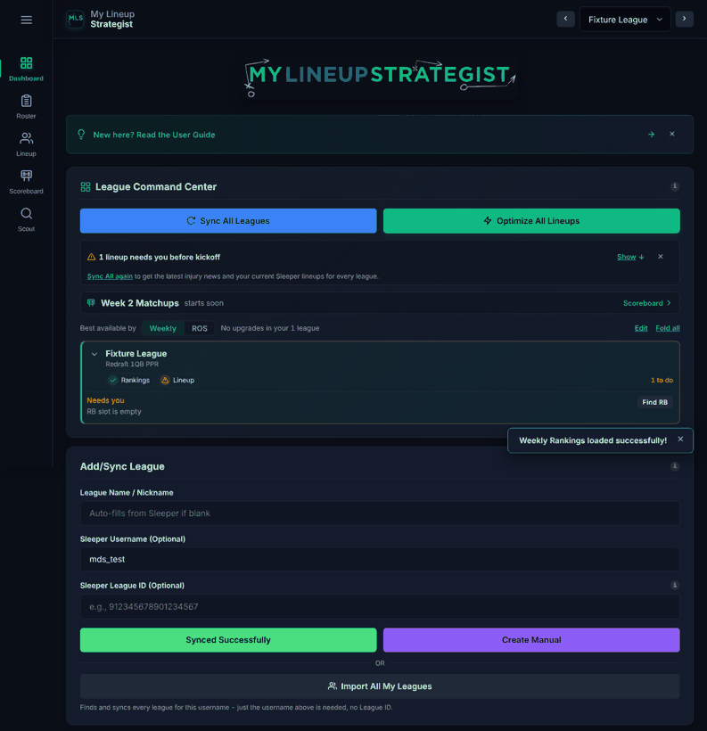
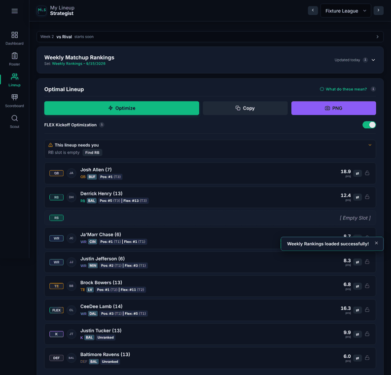
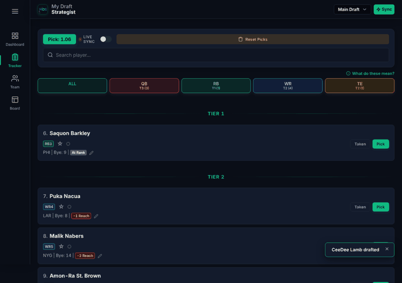
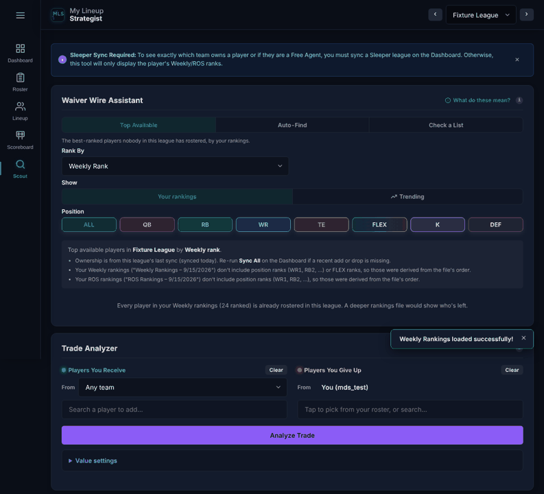

# A Material 3 review, round 2: the rest of Material 3 (improvements M1)

Research only: nothing in the apps changed. [Round 1](material3-review.md) covered the parts of Material 3 that fix
what the site already has: target sizes, focus, states, toasts, chips, dialogs, type, contrast, motion and shape. Its
14 proposals became cards M2 to M9. This round reads **the rest of Material 3**, mainly the Expressive update (May 2025)
and the layout, color-system and writing guidance, and asks what else could improve the site's **look and feel**
without changing its identity (the navy, the green, Outfit, the position colors, the green active-tab line).

**What was read** (headless Chromium, as before, all pages loaded): the
[Expressive announcement](https://m3.material.io/blog/building-with-m3-expressive); the components round 1 didn't
cover: [button groups](https://m3.material.io/components/button-groups/guidelines),
[split buttons](https://m3.material.io/components/split-button/guidelines),
[toolbars](https://m3.material.io/components/toolbars/guidelines),
[loading indicator](https://m3.material.io/components/loading-indicator/guidelines), carousel,
[search](https://m3.material.io/components/search/guidelines),
[side sheets](https://m3.material.io/components/side-sheets/guidelines), navigation drawer, FAB, extended FAB, FAB menu,
[app bars](https://m3.material.io/components/app-bars/guidelines), and again
[cards](https://m3.material.io/components/cards/guidelines), [lists](https://m3.material.io/components/lists/guidelines),
[badges](https://m3.material.io/components/badges/guidelines) and progress indicators for their Expressive changes;
styles: [color roles](https://m3.material.io/styles/color/roles) (the surface containers), elevation,
[shape](https://m3.material.io/styles/shape/overview-principles) (the shape library and morphing),
[motion specs](https://m3.material.io/styles/motion/overview/specs) (springs, and their web curves), icons, spacing,
[editorial type](https://m3.material.io/styles/typography/editorial-treatments); foundations:
[canonical layouts](https://m3.material.io/foundations/layout/canonical-examples), scaffold, breakpoints, grids,
[the writing style guide](https://m3.material.io/foundations/content-design/style-guide), selection, gestures.

**What Expressive asks for**, in its own words ("expressive tactics"): use a variety of shapes; apply rich and nuanced
colors ("create visual hierarchy with surface tones"); guide attention with typography; **contain content for emphasis**
("give the most important content visual prominence through ample space and the brightest surface"); add fluid and
natural motion; leverage component flexibility (adapt to large screens through canonical layouts); and combine them into
one or two **hero moments**.

Then every tab of both apps and T-Score was looked at again at 1280px (the round 1 screenshots and measurements, with the
fixture data) with those tactics in mind.

## The owner's picks

All three corrections and all nine proposals, grouped into cards M10 to M14 or folded into M3, M5, M7, M8 and M9 (also in
[LOG.md](LOG.md), under M1 round 2):

- **Corrections, all accepted:** M2 offers Expressive's pressed shape morph (corners tighten about 2px) beside the state
  layer; M3 uses Expressive's web curves (spatial ones overshoot a little; the toast's entrance is the owner's call: a
  small bounce or none); M4 becomes Expressive's connected button group, one look for every segmented control on the
  three pages (Lineup Strategist's segments, T-Score's WR / RB pills), with the check optional.
- **Folded into existing cards:** 17 (progress and loading indicators) into **M3** (both are about how the app shows
  it's working, and the loading shape uses M3's motion tokens; M3 grows to ~24k); 23 (search bars) into **M5** (text
  fields; ~26k); 21 (sentence case) into **M7** and **M8**, which re-take the same screenshots anyway (~30k and ~26k);
  22 (button group and Share split button) into **M9**, whose corners (14) moved to M14.
- **New cards:** **M10** navigation badges and hero moments (16 + 20: both rest on "a lineup needs you" and "you're on
  the clock"; ~20k); **M11** the badge legend in a sheet (15; builds the shared sheet, so **S32 now needs M11**; ~12k);
  **M12** two panes on wide screens for Lineup Strategist and **M13** for Draft Strategist (18, one per app; ~20k and
  ~16k); **M14** surface tones and corners (19 + 14: both change every container and the identity a little, so one
  card with mock-ups first; ~25k; M9 now follows it).
- **Order, by expected impact** (owner: changes mid-season are fine, this season is a beta): weeks 10–11 add **M2**
  (felt on every tap) and **M11**; weeks 12–13 add **M10** beside S30, with S32 after M11; the playoffs start with
  **M3**, then S18 on its motion tokens; January **M5** and **M12** beside S25; February–March **M4**, **M6**, **M7**
  one at a time; spring and summer **M13** before draft season, then **M8**, **M14** and **M9**. Runbook updated the
  same day (version 33): those cards, S28 marked merged (#213), S32's need on M11.

## First: three corrections to cards already written

Round 1 read Material 3's baseline pages. Two of them have since been superseded by Expressive, and one card can use an
Expressive detail. These change cards, not add them:

1. **M3 (motion): use Expressive's web curves, not the baseline ones.** The easing-and-duration page round 1 quoted now
   says it "is no longer maintained"; Expressive moved to springs, and for the web
   [its specs](https://m3.material.io/styles/motion/overview/specs) give curves that mimic them: **spatial** (things that
   move) `cubic-bezier(0.42, 1.67, 0.21, 0.90)` 350ms fast, `(0.38, 1.21, 0.22, 1.00)` 500ms default; **effects** (fades
   and color) `(0.31, 0.94, 0.34, 1.00)` 150ms fast, `(0.34, 0.80, 0.34, 1.00)` 200ms default. The spatial ones overshoot
   a little **on purpose** ("the expressive motion scheme overshoots the final values to add bounce"). So round 1's "no
   bounce" for the toast was the baseline's view: under Expressive the toast keeps a small, quick overshoot (the fast
   spatial curve, 350ms) in place of today's larger 400ms one. M3's tokens become spatial fast / default / slow and
   effects fast / default / slow. Your call on the toast: Expressive's small bounce (my suggestion), or none.
2. **M4 (chips and segments): Expressive's connected button group replaces the segmented button**, which Material 3 now
   calls "no longer recommended". The selected button in a connected group changes **shape** (rounder corners) and color;
   the check is optional. Today the site has three looks for the same control: Lineup Strategist's square tinted segments,
   T-Score's pill buttons (Wide Receivers / Running Backs, below) and the position chips. M4 should make them one connected
   button group style, with the selected one marked by fill **and** a shape change (and the check, if you still want it).
3. **M2 (press feedback): Expressive buttons morph when pressed**: their corners tighten
   ([buttons specs](https://m3.material.io/components/buttons/specs): the pressed state's corner radius drops, e.g. 12 to
   8dp). That is the Expressive answer to today's shrink-to-98%. M2 can offer it beside the state layer: the corners
   tighten 2px while pressed (spatial fast curve), nothing moves.

## The new proposals, ranked

Numbering carries on from round 1. Screenshots count the 42 baselines.

| # | Proposal | Gives a user | Size | Screenshots | Scope | Overlaps |
|---|---|---|---|---|---|---|
| 15 | The badge legend in a sheet, not a trip to the Guide | Look up a badge without losing your place | ~12k tok | 0 | both apps | S32 (reuses the sheet) |
| 16 | Badges on the navigation | See that a lineup needs you, or that you're on the clock, from any tab | ~10k tok | 0 to 14 | both apps | S11, legends |
| 17 | Progress and loading indicators | Long syncs show how far along they are | ~10k tok | 0 | site-wide | F2 |
| 18 | Two panes on wide screens (canonical layouts) | Your team beside the player list while drafting; less scrolling on a computer | ~20k tok per app | that app's desktop PNGs | tab by tab | S26's standard rail follow-up |
| 19 | Surface tones instead of boxes in boxes | Clearer hierarchy: the card that matters stands out | ~20k tok | all 42 | site-wide | M6, M9 (identity) |
| 20 | One or two hero moments | The moments that matter feel like it | ~12k tok | 0 to 4 | both apps | S27, S21 |
| 21 | Sentence case for headings, buttons and labels | Calmer, easier-to-read text | ~12k tok | most | site-wide | M7, M8 (fold in) |
| 22 | The Lineup card's actions as a button group and split button | One clear main action, fewer buttons | (in M9) | (in M9) | both apps | M9 (fold in) |
| 23 | Search fields that look and behave like search | Faster player lookups, headshots in results | ~8k tok | 2 to 4 | both apps | none |

Each is described below with what Material 3 says, what the site does now and the change.

---

### 15. The badge legend in a sheet

**Material 3.** [Side sheets](https://m3.material.io/components/side-sheets/guidelines): "supplementary surfaces ...
for contextual actions and information"; modal on phones, where Material 3 prefers a
[bottom sheet](https://m3.material.io/components/bottom-sheets/guidelines) (half height, drag handle, swipe down to close).

**The site now.** "What do these mean?" on the Lineup, Roster, Scout and Tracker cards switches to the Guide tab and
scrolls to the legend (`openBadgeLegend`, js/mls/main.js). You lose your place, then come back.

**Change.** The same legend (`js/mls/legend.js`, `js/mds/legend.js`, already one function that draws it) opens in a
modal side sheet from 840px and a bottom sheet below, over the tab you're on, with a link to the full Guide at its foot.
Builds one shared sheet in js/shared/ui/ (focus trap, Escape, Back, swipe down, Reduce Motion) that **S32 can reuse** for
the Lineup row's details, so it's worth doing before S32. Files: js/shared/ui/ (new module, so `PRECACHE_ASSETS`),
css/base.css, both apps' main.js. Screenshots: none (sheets are closed in the baselines).

### 16. Badges on the navigation

**Material 3.** [Badges](https://m3.material.io/components/badges/guidelines) "show notifications, counts, or status
information on navigation items": a small dot for "something new", a large badge with a count.

**The site now.** Whether a lineup needs you before kickoff shows only on the Dashboard (S11's box) and the Lineup tab.
From the Scoreboard or Scout tab nothing says so. In Draft Strategist with Live Sync on, nothing outside the Tracker
says it's your pick.

**Change.** A count badge on the **Dashboard** item (leagues that need you before kickoff, from S11's same check) and a
dot on **Lineup** when the open league needs you; in Draft Strategist a dot on **Tracker** when you're on the clock (if it can tell which slot is yours: Live Sync maps Sleeper's teams to slots, `js/mds/sleeperSync.js`; the card checks first).
Green or amber, not red (they're to-dos, not errors), with the count in the item's accessible name ("Dashboard, 2 lineups
need you"). A new badge means a line in each Guide legend (CLAUDE.md). Files: css/base.css (the bar and rail),
js/mls/nav.js, js/mds/ui.js, the S11 check. Screenshots: the fixture league has one to-do, so Lineup Strategist's 14 PNGs
show the badge, unless the badge waits for kickoff to be within a day (my suggestion: always, like S11's box, so it's
in all 14). Draft Strategist's: none (no live draft in the fixture).

### 17. Progress and loading indicators

**Material 3.** [Loading indicator](https://m3.material.io/components/loading-indicator/guidelines) (Expressive, new):
for waits of 200ms to 5s, a shape that morphs as it spins; under 200ms nothing; over 5s a
[progress indicator](https://m3.material.io/components/progress-indicators/guidelines), determinate when the progress is
known.

**The site now.** A spinner inside the button for every wait; Sync All and Import All My Leagues write "Syncing 2/5…" in
the button's label (F2 stopped the spinner restarting). The Matchup Simulator runs with its own text.

**Change.** Sync All, Import All and the Simulator get a thin **determinate** linear progress bar in the brand green under
the button (2/5 = 40%), with the count kept in text for screen readers; short waits keep a spinner but in Expressive's
style (a morphing rounded shape, CSS only, still under Reduce Motion), shown only after 200ms so instant actions don't
flash. Files: css/base.css, js/mls/render/dashboard.js (Sync All), js/mls/leagues/importAll.js, js/mls/sim/, js/shared/ui/statusFeedback.js. Screenshots: none.

### 18. Two panes on wide screens (canonical layouts)

**Material 3.** [Canonical layouts](https://m3.material.io/foundations/layout/canonical-examples): on expanded windows,
**list-detail** (a list beside the selected item) and **supporting pane** (the main content in about two thirds, related
content beside it) rather than one long column; a **feed** grid for many similar cards.

**The site now.** Every tab is one column up to 1200px wide, so on a computer fields stretch to ~670px, a lineup row is
1100px wide with its numbers far from its name, and related cards sit far apart vertically: on the Tracker your team is a
different tab; on the Scout tab the Trade Analyzer is a screen below the Waiver Wire Assistant.

**Change**, from 1200px (phones and tablets unchanged), tab by tab, each your pick:
- **Draft Strategist's Tracker**: the player list in two thirds, **your team and positional needs** in a supporting pane
  that stays in view (today's Team tab content, compact). The strongest one: mid-draft you check both every pick. For
  next draft season.
- **Lineup tab**: Optimal Lineup beside Bench Priorities and the weekly rankings card.
- **Scout tab**: the Waiver Wire Assistant and the Trade Analyzer side by side.
- **Dashboard**: the Command Center's league cards as a **feed grid** (two or three across; the Scoreboard's tiles already
  do this), with Add/Sync League and the requirements in a supporting pane.
Fits with the open follow-up for a standard (side-by-side) expanded rail from 1600px. Files: css/mls.css and css/mds.css
(grid areas on the tab containers), maybe the order of sections in the HTML. Screenshots: that tab's desktop PNGs (1 or 2
per tab). One card per app (~20k each), or one per tab if you pick only some.

### 19. Surface tones instead of boxes in boxes

**Material 3.** [Color roles](https://m3.material.io/styles/color/roles): five **surface container** tones (lowest to
highest) for "hierarchy and nested containers"; in a dark theme a nested or more important container is a **lighter**
tone. [Elevation](https://m3.material.io/styles/elevation/overview) on dark surfaces is shown by tone more than shadow.
[Cards](https://m3.material.io/components/cards/guidelines) come in three kinds (elevated, filled, outlined), chosen for
emphasis. Expressive: "contain content for emphasis ... the brightest surface" for what matters most.

**The site now.** Every card is the same: the card navy `#131b2c`, a 1px border **and** a drop shadow (which barely shows
on navy). Inside cards, rows are bordered boxes again (a card in a card: the lineup rows, the Tracker's player cards), and
fields and toggle rows go **darker** (a black overlay at 15 to 20%), the opposite of Material 3's direction. Nothing marks
the one card on a tab that matters most (Optimal Lineup, the Command Center, the Tracker's on-the-clock bar).

**Change.** Navy surface tokens, all the same hue as today: the page `#0a0e17` (unchanged), cards one step up
(`#131b2c`, unchanged), rows and fields inside a card one step lighter again (no black overlays, no second border), and
the tab's main card a step brighter still or with a faint green tint. Cards keep the border and lose the shadow (or the
reverse, your pick). **Identity:** the navy family stays, but the inside of cards gets lighter than today; mock-ups first.
Re-takes all 42 PNGs, so it's best done with M9 (which re-takes most of them anyway). ~20k.

### 20. One or two hero moments

**Material 3.** Expressive: "hero moments use multiple expressive tactics ... to frame essential information in a fresh,
editorial way. Stick to one or two." [Editorial type](https://m3.material.io/styles/typography/editorial-treatments):
large, bold type that "can freely dominate the screen" for such a moment. Outfit is a variable font (weights 400 to 700
self-hosted), which suits it.

**The site now.** The live matchup on the Lineup tab is a one-line strip ("Week 2 vs Rival starts soon"); the Scoreboard's
tiles are small; Draft Strategist's "Pick: 1.06" is a small green box.

**Change**, pick one or two:
- **Your matchup while it's live** (Lineup tab strip, expanding): the two scores in large display type, the win chance
  under them, and a short spatial animation when the lead changes.
- **On the clock** in Draft Strategist: when it's your pick (the same check as proposal 16's dot), the Tracker's top bar grows into a bold
  "You're on the clock" with the pick number, and settles back after you pick.
- **The Week Recap** (S21 / S22): the week's MVP in editorial type.
Screenshots: 0 to 4 (the fixture's matchup isn't live; the recap may show). ~12k.

### 21. Sentence case

**Material 3.** [Style guide](https://m3.material.io/foundations/content-design/style-guide): "Use sentence case ...
All text, including titles, headings, labels, menu items, navigation components"; "Don't use title case." Product
names keep their capitals.

**The site now.** Mostly Title Case ("Optimize All Lineups", "Add/Sync League", "Players You Receive", "Weekly Matchup
Rankings", "Bench Priorities"), with some sentence case already ("Value settings", "Choose leagues"): mixed.

**Change.** Sentence case everywhere users read it, keeping names in capitals (Lineup Strategist, Sleeper, T-Score,
FLEX, ROS, PPR). It changes the voice slightly, so it's your call. It touches most screenshots and many specs (which find
buttons by name), so **fold it into M7 and M8**, which re-take those screenshots anyway. +~6k to each.

### 22. Button groups and a split button for the Lineup card (fold into M9)

**Material 3.** [Button groups](https://m3.material.io/components/button-groups/guidelines) (Expressive): related buttons
in one group, mixing widths to show what's important. [Split button](https://m3.material.io/components/split-button/guidelines):
a main action with a menu of related ones beside it, "reduces visual complexity by hiding extra options".

**The site now.** The Lineup card has three equal-weight buttons, two of them filled (green Optimize, gray Copy, purple
PNG); Draft Strategist's Team tab and the Trade Analyzer have the same Copy / image pair.

**Change.** A button group: Optimize wide and filled, then a **split button "Share"** (Copy as text, Save image) in tonal
style. Fewer colors in one row, one clear main action. Fits M9's button-emphasis question, so it goes there as an option.

### 23. Search fields that look like search

**Material 3.** [Search](https://m3.material.io/components/search/guidelines): a search bar with a leading search icon,
fully rounded; when focused it shows suggestions or results in a list, "include high-priority items like avatars".

**The site now.** The Tracker's "Search player..." is a text field with an icon; the Trade Analyzer's pickers list names.

**Change.** Both as search bars (keep the site's corner radius if you prefer, M9's question), results as list rows with the
headshot, position badge and team. Screenshots: the Tracker's (2 to 4). ~8k. Lowest of the new ones.

## Looked at and not proposed

- **FAB and extended FAB**: the site's main actions belong to a card (Optimize to the lineup, Pick to a player), not to a
  screen; a floating button would sit over the rows and the toasts above the bar.
- **Toolbars**: Material 3 puts them on secondary pages with page actions; the apps' tabs are all primary pages with the
  bar or rail. The Tracker's top bar already works like a docked toolbar.
- **Carousel, date and time pickers, sliders beyond MDS's**: nothing on the site needs them.
- **The shape library** (35 abstract shapes, cookie and clover avatars): decorative; the headshots and initials stay
  circles. Shape morphing is used where it means something (corrections 2 and 3 above).
- **Material Symbols icons**: Feather-style SVG is the site's (owner's rule).
- **Navigation drawer**: the expanded rail and phone drawer already follow it (S26).
- **App bars' flexible and search variants**: the header holds the league switcher, which is the right job for it; a large
  collapsing title would cost room on phones.
- **Dynamic color, a light theme**: out of scope.
