# A Material 3 review of the whole site (improvements M1)

Research only: nothing in the apps changed. This is the list of proposed changes for the owner to pick from. The ones
picked become runbook cards M2 onward (the owner's picks are in [LOG.md](LOG.md), under M1).

**What was reviewed.** Draft Strategist (`/`), Lineup Strategist (`/lineup/`) and T-Score (`/t-score/`), every tab, at
375, 768 and 1280px wide, with the tests' fixture data (the Sleeper fixture league synced, the 24-player rankings loaded
as ROS and Weekly, five picks made in Draft Strategist). On each tab a throwaway Playwright script measured every
control's size, focused each one from the keyboard and looked for a ring, collected every font size, transition and
corner radius in use, and checked text contrast against the background behind it. Then the toasts, the confirm and
text-input dialogs and the upload preview were opened at 375 and 1280px. The script wasn't committed (research only);
its numbers are quoted below.

**What it was checked against.** m3.material.io's Guidelines, Specs and Accessibility pages for buttons, icon buttons,
segmented buttons, chips, dialogs, bottom sheets, snackbars, text fields, lists, cards, menus, switches, checkboxes,
tooltips, progress indicators, tabs, the top app bar, the navigation bar, badges, dividers, radio buttons and sliders,
plus Styles (the type scale, color roles, elevation, shape, easing and duration) and Foundations (states and state
layers, window sizes, spacing, color contrast). Read in headless Chromium, as S26 did (a plain fetch gets only the page
title): all 82 pages loaded.

**The identity stays** and nothing below changes it unless it says so plainly: the navy header, bar and rail (the
header's `#0a0e17`), the cards' lighter navy, the green accent (`#10b981`), Outfit, the position colors, and the choices
made against Material 3 on purpose in S21 and S26: the green sliding line under (or beside) the active tab instead of
Material 3's pill, a bar rather than a rail on tablets, and the modal (not standard) expanded rail. Material You's
dynamic color and a component library are out of scope.

## What already meets Material 3

- **Navigation** (S21, S26): window sizes (bar under 600px, rail from 840px), 96px rail, 64px bar, 24px icons, item
  spacing, labels on every tab, whole at 2x text, the active tab's heavier icon and bold label, `aria-current`, arrow keys,
  the menu at the top of the rail, the expanded rail growing out of it with Material 3's emphasized easing, Back closing it.
- **Dark surfaces**: the page, header and bar are the darkest layer and cards the lighter one, with dividers between.
  That is how Material 3's dark theme shows depth (surface tones rather than shadows).
- **Dialogs**: a scrim behind, focus kept inside, Escape closes, the dismissive button on the left and the confirming
  one on the right (Material 3's order), the title and buttons pinned while the middle scrolls (F10, merged in #212).
- **Toasts**: one at a time, a newer one replaces the older, `aria-live`, the countdown pauses on hover and focus, errors
  can be held open. (What differs from Material 3's snackbar is in proposal 4.)
- **Reduce Motion** is honored everywhere that animates; the skip link works; phone primaries and the header's league
  arrows are 44px (Apple's minimum; Material 3 asks 48, see proposal 1).

## The proposals, ranked

Ranked by what each gives a user against what it costs. "Screenshots" counts the 42 baselines (21 desktop, 21 phone:
Draft Strategist 16, Lineup Strategist 14, T-Score 12) a card would re-take. None of the baselines shows a focus ring,
a hover, a pressed state, a toast (`tests/hide-transient.css` hides it) or a dialog, so the first four re-take few or none.

| # | Proposal | Gives a user | Size | Screenshots | Scope | Overlaps |
|---|---|---|---|---|---|---|
| 1 | Every control a 48px touch target | Fewer missed taps on the Lineup and Tracker rows | ~12k tok | 0 to 4 | site-wide | S32 (phone rows) |
| 2 | One visible focus ring everywhere | Keyboard users always see where they are | ~8k tok | 0 | site-wide | S15 (its focus half) |
| 3 | State layers for hover and press | Every tap and hover answers the same way | ~12k tok | 0 | site-wide | S18 (motion) |
| 4 | Toasts that behave like snackbars | Messages stay long enough to read, never over a dialog | ~8k tok | 0 | site-wide | none |
| 5 | Selected chips and segments show a check | Selection that doesn't rely on color | ~10k tok | 4 to 6 | app by app | none |
| 6 | Contrast fixes found by the check | Badges and labels readable in sunlight | ~10k tok | ~20 | app by app | S15 (its contrast half) |
| 7 | Dialogs: say what they do; full-screen preview on phones | Clearer confirmations; more room for the upload preview | ~10k tok | 0 | site-wide | F10 (merged) |
| 8 | Motion tokens: Material 3's durations and easing | Calmer, consistent movement | ~8k tok | 0 | site-wide | S18, S16 |
| 9 | A type scale with an 11px floor | Small print readable; one set of sizes | ~20k tok per app | all of that app's | app by app | S32 |
| 10 | T-Score's tabs as tabs, with the green line | T-Score looks like the other two pages | ~8k tok | 12 (T-Score) | T-Score only | none |
| 11 | One filled button per area | The main action stands out | ~12k tok | ~16 | app by app | identity (colors) |
| 12 | Switches at Material 3's size, with a check | Easier to hit, on/off clear without color | ~6k tok | ~12 | site-wide | none |
| 13 | Errors under the field, not only in a toast | You see what to fix where you typed it | ~10k tok | 0 | app by app | none |
| 14 | Corner radii on Material 3's shape scale | Tidier, one set of corners | ~8k tok | most | site-wide | identity (shape) |

Not a card of its own: **a bottom sheet for the Lineup row's extras on phones** belongs in S32 (see "Dialogs and
sheets").

Suggested grouping if the owner wants fewer cards: **1 + 2 + 3** (one "touch, focus and feedback" card, ~25k tok, it
replaces S15's focus half), **4 + 8** (one motion-and-messages card, fits beside S18), **5 + 12** (selection controls),
**6** absorbs the rest of S15.

---

## Navigation and app bars

**Material 3.** [Top app bar](https://m3.material.io/components/top-app-bar/guidelines): a 64dp small app bar, a leading
navigation icon and trailing actions, each an icon button with a
[48dp target](https://m3.material.io/components/icon-buttons/accessibility).
[Tabs](https://m3.material.io/components/tabs/guidelines): an underline indicator under the active tab, scrollable tabs
when they don't fit. Navigation bar and rail: met (S21, S26).

**The site now.** The header is 62px on phones and 70px on computers; its menu button is 32x32px, the league arrows
44x44px. T-Score's six sections are rounded pill buttons in a sideways-scrolling row, the active one outlined green, unlike
the apps' green line.

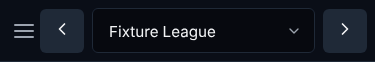
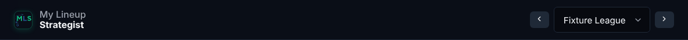
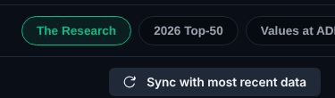

**Proposals.** The menu button's 48px target goes into proposal 1. **Proposal 10:** T-Score's row becomes Material 3
scrollable tabs: text tabs with the same 3px green line under the active one as the apps' bar (it reuses
`placeTabMarker` from `js/shared/ui/viewTransition.js`), arrow keys between them (`role="tablist"`). Files: `t-score/index.html`,
`css/tscore.css`, `js/tscore/main.js`. Re-takes T-Score's 12 PNGs. This moves T-Score toward the identity, not away.

## Buttons and icon buttons

**Material 3.** [Buttons](https://m3.material.io/components/buttons/guidelines): an emphasis order (filled, tonal,
outlined, text), with one filled button for a screen area's main action;
[a 48dp target for every size](https://m3.material.io/components/buttons/accessibility), even the 32dp extra-small
buttons. States are shown by a [state layer](https://m3.material.io/foundations/interaction/states/state-layers): the
content's color laid over the button at 8% on hover, 10% on focus and press, not by moving the button.

**The site now.**
- **Sizes**: on phones 48 to 110 of the visible controls on each app tab are under 48px in one direction. The worst are
  on the rows used every week: the Lineup tab's swap button is **30x23px** and the lock **26x21px**, stacked with no gap;
  Draft Strategist's **Taken** and **Pick** are 64x30 and 54x30; the "i" tooltip icons are **18x18px** (17 on the Lineup
  tab alone); the toast's close button is about 32px; several text links (Badges, the "fold all" links on the Dashboard,
  "Check" in the needs box) are 15 to 20px tall. Under WCAG 2.2's 24px minimum: the tooltip icons, the lock, the sync
  toggles (37x20), and those links.
- **Emphasis**: filled buttons in five colors: green (Optimize, Pick, Sync), purple (PNG, Create Manual), blue, amber
  (Reset Picks) and the red-outlined danger button. On the Lineup card, green Optimize and purple PNG are both filled side
  by side; Copy between them is already tonal (gray).
- **States**: `.btn` lifts 1px on hover, sinks and shrinks to 98% when pressed, and the primary brightens (`filter`);
  `.btn-sm` changes color; phones turn off the tap highlight, so a tap on most small buttons shows nothing until the
  result arrives.

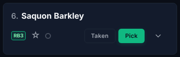
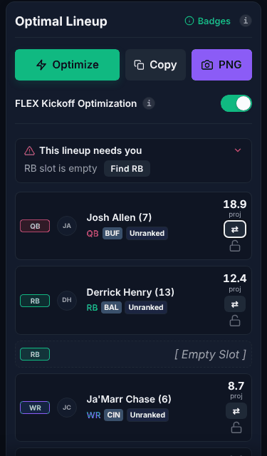

**Proposals.**
- **1. 48px targets.** Most controls keep their look and get an invisible hit area (a `::after` inset to 48x48px, the
  pattern `.close-banner-btn` already uses), with neighbors kept 48px apart center to center. The lineup row's swap and
  lock need room (side by side rather than stacked, or a taller row), which is S32's phone-row redesign: fold that part
  into S32 and do everything else here. Phone primaries and the league arrows move from 44 to 48px. Files: `css/base.css`
  (one shared rule), `css/mls.css`, `css/mds.css`. Screenshots: none for hit areas; 2 to 4 if the 44 to 48px change shows
  (phone Setup and Lineup).
- **3. State layers.** One shared rule: a `::before` in the content's color at 8% on hover, 10% on press (and 10% on
  focus where there's no ring), fading at Material 3's short duration, instead of the lift, the shrink and the brightness
  filter. Phones get the press layer as the touch feedback (Material 3's ripple, without the ripple). Files: `css/base.css`
  plus the per-app hover rules it replaces. Screenshots: none (the baselines park the mouse). Site-wide.
- **11. One filled button per area.** Keep green filled for each area's main action; the others become tonal (the gray
  Copy already is) or outlined. **This changes the identity**: purple PNG and Create Manual, the blue buttons and amber
  Reset Picks would lose their fill (they could keep their color as an outline or text). The owner's call. About 16 PNGs
  (both apps' Setup, Lineup, Tracker, Team). App by app.

## Chips and segmented buttons

**Material 3.** [Segmented buttons](https://m3.material.io/components/segmented-buttons/guidelines): 2 to 5 segments,
40dp tall ([specs](https://m3.material.io/components/segmented-buttons/specs), 48dp target), the selected segment marked
with a check icon as well as a fill. [Chips](https://m3.material.io/components/chips/guidelines): **filter** chips for
filters (a check when selected), **assist** chips for actions, **input** chips for things you entered (with an ✕); 32dp
tall with a 48dp target; a chip row may scroll sideways.

**The site now.** Segmented controls (Top Available / Auto-Find / Check a List; Your rankings / Trending; Dynasty /
In-Season; the Best Available basis) are 35px tall; the selected one is a green tint with green text, no check. The
position chips (All, QB, RB, ...) are filter chips in their position colors; which one is on is shown only by its fill,
and with every chip already colored that is hard to see (the screenshot has ALL selected). The Trade Analyzer's player
tokens are input chips and already have an ✕ (meets).

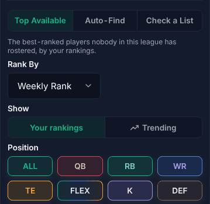

**Proposal 5.** A check icon (inline SVG, Feather's `check`) in front of the selected segment's label and the selected
filter chips' labels, as Material 3 does, so selection doesn't rely on color (WCAG 1.4.1); segments 40px tall. The
position colors stay. Files: `css/base.css`, `js/mls/scout/` (the Waiver Wire Assistant and Best Available),
`js/mls/rankings/sets.js` (Dynasty / In-Season), Draft Strategist's position chips (`js/mds/tracker.js`), and both apps' Guide
legends if a chip's look changes (CLAUDE.md's legend rule). Screenshots: `mls-league-scout` and `mds-draft-tracker` /
`mds-empty-tracker` (desktop and phone), 4 to 6. App by app.

## Dialogs and sheets

**Material 3.** [Dialogs](https://m3.material.io/components/dialogs/guidelines): the headline says what the dialog is for
("Delete Fixture League?", not "Are you sure?"), buttons are named for their action. On phones (compact width), a task
with several steps or a long list belongs in a **full-screen dialog** with a close ✕ and the confirming action in its app
bar; basic dialogs stay for alerts and quick choices. Basic dialogs: 280 to 560dp wide, 24dp padding, a 28dp corner
radius ([specs](https://m3.material.io/components/dialogs/specs)). Nothing should cover a dialog.
[Bottom sheets](https://m3.material.io/components/bottom-sheets/guidelines): on phones, a modal bottom sheet is the
alternative to a menu or simple dialog, especially for a list of actions with descriptions; it opens at no more than
half the screen, has a drag handle, and closes on a swipe down or a tap on the scrim.

**The site now.** The confirm dialog's headline is always "Are you sure?" (the message under it says what). The upload
preview on a phone is a 327px card over the page (F10 pinned its buttons). A toast sits **on top of** an open dialog and
its scrim (z-index 9999 against the dialog's 2000): in both screenshots below the error toast covers the dialog's lower
edge. The card radius is 10px (cards 12px).

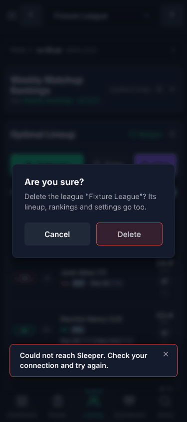
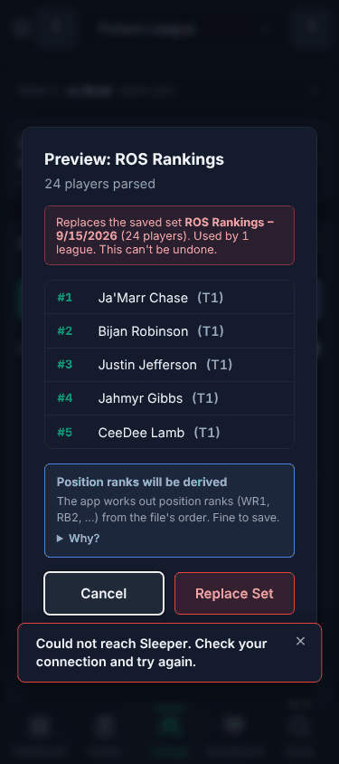

**Proposal 7.** `showConfirm` takes a headline from each caller ("Delete Fixture League?", "Replace ROS Rankings?") and
falls back to today's; the upload preview becomes full-screen under 600px (the same markup; the card fills the window,
its title row gets the ✕); toasts wait (or go under the scrim) while a dialog is open (that part is in proposal 4).
The 10px radius stays (Material 3's 28dp would look out of place next to 12px cards); the owner can ask otherwise.
Files: `js/shared/ui/confirm.js` and its callers, `css/base.css`'s modal rules, `js/shared/ui/modalLayout.js`.
Screenshots: none (no baseline shows a dialog). Site-wide.

**For S32** (not a card here): the owner asked for the Lineup row's extras to move into "a drop-down or pop-up" on phones.
Material 3's answer on phones is a **modal bottom sheet** (half height, drag handle, swipe down to close); on computers,
a menu. S32 should offer that as one of its options.

## Lists and rows

**Material 3.** [Lists](https://m3.material.io/components/lists/guidelines): one-, two- and three-line rows of 56, 72 and
88dp, a leading element (avatar, icon), a trailing element (a value, an icon button), dividers optional, every control in
a row a 48dp target. [Cards](https://m3.material.io/components/cards/guidelines): 12dp corners (the site's cards are 12px:
meets).

**The site now.** The Lineup and Roster rows are bordered boxes holding the position badge, the headshot, the name, a
line of chips, the projection and the swap and lock stacked at the right (in the lineup screenshot above). The Scoreboard's
league tiles are already Material 3 list rows (a title, a second line, a trailing chevron, the whole row a target):

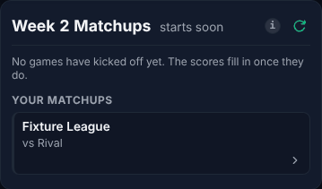

**Proposal:** none separate. The phone rows are S32's; the 48px targets in them are proposal 1's part that folds into S32.

## Text fields and pickers

**Material 3.** [Text fields](https://m3.material.io/components/text-fields/guidelines): filled or outlined, 56dp tall,
a label, optional supporting text under the field, and an **error state under the field** (error color, a message saying
what to fix). Focus: the outline thickens to 2dp in the primary color (3dp for filled).

**The site now.** Outlined fields with the label above (fine on the web), 45px tall on the Setup tab, 34px in some
smaller forms. Focus turns the 1px border green with a faint 3px glow at 15%: in the screenshot the focused "Sleeper
Username" field is hard to pick out. Errors from the sync form (a wrong username or league ID) come only as a toast.
Selects are the browser's own (on phones the system picker, which is already sheet-like: keep).

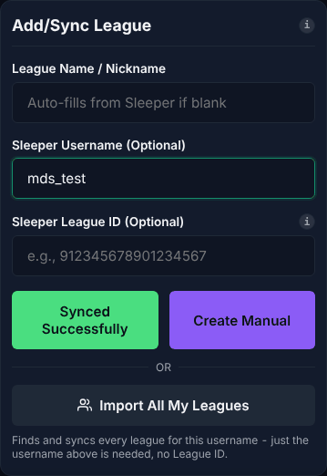

**Proposals.** The focus outline goes into **proposal 2** (a 2px green outline, Material 3's). **Proposal 13:** the sync
form and the Draft Strategist Sleeper form show their errors under the field, in the error color, kept until the value
changes (the toast can stay too). Files: `js/mls/leagues/` (the sync), `js/mds/sleeperSync.js`, `css/base.css`. Screenshots:
none (the baselines show no error). App by app.

## Toasts as snackbars

**Material 3.** [Snackbars](https://m3.material.io/components/snackbar/guidelines): at the bottom, above the navigation
bar and never over it or over a dialog; on wide screens left-aligned or centered (not flush to one edge); opaque; no icons;
at most one action; an action keeps it on screen until used or dismissed. Without an action it may go after **4 to 10
seconds**, but on the web an auto-dismissing snackbar must also have inline feedback or be actionable
([accessibility](https://m3.material.io/components/snackbar/accessibility)). Entering: emphasized decelerate; leaving:
emphasized accelerate.

**The site now.** Success toasts go after 3.5s, errors after 6s (a tap holds them). On computers the toast sits at the
bottom right, 24px from the edge. It slides in with an overshoot bounce (`cubic-bezier(0.175, 0.885, 0.32, 1.275)`,
400ms). It sits over open dialogs. The navy card with a green (or red) border is the identity and stays.

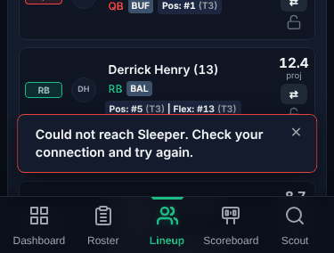
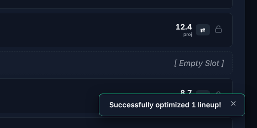

**Proposal 4.** Success toasts last 4 to 6s by length; error toasts stay until their ✕ (they already have one: Material 3's
"with an action" case); centered at the bottom on computers, clear of the rail; no toast over an open dialog (it waits,
then shows); enter with emphasized decelerate 400ms and leave with emphasized accelerate 200ms (no bounce). Where a toast
is the only confirmation of something important, the card that does the work should say it too (e.g. "Synced" on the
button, which the sync button already does: keep that pattern). Files: `js/shared/ui/toast.js`, `css/base.css`.
Screenshots: none. Site-wide.

## The type scale

**Material 3.** [Type scale](https://m3.material.io/styles/typography/type-scale-tokens): 15 styles from Display Large
to Label Small: Label Small 11/16 is the smallest, then 12/16 (Label Medium, Body Small), 14/20 (Label Large, Body
Medium, Title Small), 16/24 (Body Large, Title Medium), 22/28 (Title Large), 24/32, 28/36, 32/40 (Headlines), 36 to 57
(Displays). [Applying type](https://m3.material.io/styles/typography/applying-type): a product picks the styles it needs
and uses them consistently; a brand font (Outfit) is fine for all of them.

**The site now.** The stylesheets declare **35 different font sizes** in 434 rules (most often 0.75rem, 0.85rem, 0.8rem,
0.78rem, 0.7rem, 0.72rem). On screen at 375px: 27 sizes, nine of them **under 11px** (8.8, 9.28, 9.6, 9.92, 10.4px):
10.4px text appears 253 times across the tabs (badge and chip text, "proj" labels, table headers), and the Draft Board's
empty pick numbers are 9.28px at 2.99:1.

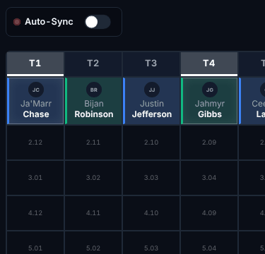

**Proposal 9.** Type tokens in `css/base.css` (`--type-label-s` 11px through `--type-headline-s` 24px, with Material 3's
line heights), sizes moved onto them, nothing under 11px. Outfit stays. Every screen changes a little, so it re-takes every
PNG of the app it touches; it can go **one page at a time** (T-Score 12 PNGs, Draft Strategist 16, Lineup Strategist 14),
best after S32 for Lineup Strategist (S32 redoes the phone rows' text anyway).

## Color and states

**Material 3.** [Color roles](https://m3.material.io/styles/color/roles): text on a surface uses on-surface (or
on-surface-variant for secondary text); [contrast](https://m3.material.io/foundations/designing/color-contrast): 4.5:1
for text, 3:1 for large text and for the edges of controls that sit together.
[States](https://m3.material.io/foundations/interaction/states/applying-states): disabled content at 38% and no state
layers; hover, focus and press as overlays (proposal 3).

**The site now** (the contrast check, at 1280px; the same at the other widths):
- T-Score: the red "Boom" and warning labels `#ef4444` at 3.97:1, the purple Elite label 3.67:1, the blue High label
  3.86:1 (on its tinted fill).
- Both apps: the white-on-red injury badge 3.92:1; the DEF position color `#925d48` as text 3.2 to 3.4:1; the rank
  separator `|` 2.6:1; the move chips (green 3.26:1, light red 4.36:1); the Draft Board's empty pick numbers 2.99:1.
- Disabled buttons have no shared style: some pages dim them, some don't.

**Proposal 6** (S15's contrast half): lighter text tints of the same hues where text fails (e.g. `#f87171` for red text,
`#c4b5fd` for purple, a lighter rust for DEF text only; the DEF border and fill keep `#925d48`), the injury badge's
fill darkened a step, and one shared disabled style (38% content, no hover). **Identity:** the position colors stay as
fills and borders; only text drawn in them gets a lighter tint where it fails. About 20 PNGs (T-Score's 12 and the tabs
with badges). App by app.

## Motion

**Material 3.** [Easing and duration](https://m3.material.io/styles/motion/easing-and-duration/applying-easing-and-duration):
standard `cubic-bezier(0.2, 0, 0, 1)` 300ms for small changes on screen; emphasized decelerate `(0.05, 0.7, 0.1, 1)` 400ms
to enter; emphasized accelerate `(0.3, 0, 0.8, 0.15)` 200ms to leave; 50 to 200ms for small utility changes like hover
([tokens](https://m3.material.io/styles/motion/easing-and-duration/tokens-specs)). Material 3 Expressive moves components
to springs, but says the easing tokens remain right for transitions on the web.

**The site now.** Ten different duration and curve pairs: mostly `0.2s ease`, Material 2's `cubic-bezier(0.4, 0, 0.2, 1)`
at 0.1 to 0.3s, `0.3s ease`, a `0.275s` curve, and the toast's overshoot. The navigation (S26) already uses Material 3's
emphasized tokens.

**Proposal 8.** Motion tokens in `css/base.css` (`--motion-standard`, `--motion-enter`, `--motion-exit` and three
durations) and every transition moved onto them; Reduce Motion unchanged. Screenshots: none (animations are disabled in
the baselines). Site-wide. **Pairs with S18** (the draft switch and page-to-page transitions): one session can do both, or
S18 uses these tokens if it runs first.

## Accessibility

**Material 3.** [Focus](https://m3.material.io/foundations/interaction/states/applying-states): every interactive element
shows a keyboard focus ring when tabbed to. Targets 48dp (proposal 1). Selection not by color alone (proposal 5).
Contrast (proposal 6).

**The site now.** Of the controls the script focused from the keyboard, about 20 kinds have the site's own green ring
(the segmented buttons, the badges, the switches, the skip link and others); most buttons fall back to Chromium's default
ring (a thin white and blue line; in the lineup screenshot above, the swap button), which looks different in every
browser; text fields and selects (about 60 per pass) show only the faint green border and glow described above. The S26
nav is fully keyboard-driven (meets).

**Proposal 2** (S15's focus half): one `:focus-visible` rule for every interactive element: a 2px green outline, 2px
offset (inset where a parent clips it), Material 3's 2px outline on text fields, replacing the ~20 separate rules. Files:
`css/base.css`, and removing the per-component rules from `css/mls.css` and `css/mds.css`. Screenshots: none. Site-wide.

**Selection controls (proposal 12).** [Switches](https://m3.material.io/components/switch/specs): 52x32dp track, the handle
16dp off and 24dp on (28dp pressed), an optional check in the handle when on, a 48dp target. The site's switches are 44x24
with a 20px handle and no check. Grow them to Material 3's size and add the check (inline SVG). About 12 PNGs (the
switches on both apps' Setup, Lineup, Tracker and Board). Site-wide.

## Shape (lowest)

**Material 3.** [Corner radius scale](https://m3.material.io/styles/shape/corner-radius-scale): 4 (extra small), 8
(small), 12 (medium), 16 (large), 28 (extra large), full. Buttons are fully round by default, or 12 to 16dp square in
Expressive; chips 8dp; cards 12dp; dialogs 28dp.

**The site now.** 4, 6, 8, 10 and 12px, 999px and 50%. Buttons and fields are 6px, which is part of the site's look.

**Proposal 14.** Move 6px to 8px and 10px to 12px so every radius is on the scale; keep buttons squared (not Material 3's
full round). **Identity:** small, but it touches nearly every screen. The owner's call; ranked last.

## Not proposed, and why

- **Material 3's pill indicator, filled icons, an inverse-color (light) snackbar, 28dp dialog corners, round buttons**:
  each would change the identity for little gain; the owner's earlier choices stand.
- **Floating labels in text fields**: labels above the field are clearer on these dense forms and Material 3 allows
  outlined fields with external labels on the web.
- **Ripples**: the press state layer (proposal 3) gives the same feedback without a script.
- **Dynamic color, a component library**: out of scope.

## Left over

- Not measured: the pages at 200% text (S26 did it for the navigation only). A card that changes the type scale
  (proposal 9) should check every tab at 2x.
- The throwaway audit script could become an opt-in tool (`npm run audit:m3`) if a card wants to measure before and after.
