# How the features are organized: inventory, options and a recommendation (improvements U1)

Research for card U1 of the [improvements runbook](https://claude.ai/artifact/SF5xjaoxUyzPJM7WKCmohN), from the
owner's note of 2026-11-08: "Re-think feature organization (tabs are getting long)." No app code changes here. The
mock-ups in [`organization/`](organization/) are the real app (main at 638d808, the fixture leagues synced, the fixture
rankings loaded) with its DOM edited in Playwright, so they show what each option would look like with today's styles.
The owner's pick goes in `docs/improvements/LOG.md` (U1), and the build cards come from it.

**In one paragraph.** Lineup Strategist's tabs are long mostly because of **setup and occasional cards mixed in with
the weekly ones**, not because there are too many weekly tools. The owner uses nearly every weekly card (asked
2026-11-13: everything except the setup cards, the Matchup Simulator and the Trade Finder). On a phone, 66% of the
Dashboard is set-once cards (Add/Sync League, Active League Requirements, Advanced Settings, the Ko-fi foot); the Scout
tab opens with a 177px banner that stays after you sync and a 92px card that only says Power Rankings moved; the Lineup
tab ends with the occasional Simulator and another "moved" card. **Recommendation: option 1, tidy in place** (S45's
Settings page, the setup cards folded once you have a league, the occasional tools folded, two "moved" cards and the
banner gone, and a row of jump chips at the top of Scout and Lineup). It keeps five destinations, swipes, and one
scroll per tab, and it fits every open layout card. Options 2 (secondary tabs inside Scout) and 3 (trading moves to the
Roster tab) are below with mock-ups.

## 1. Inventory at 375px

Measured with `page.evaluate` on each tab at 375 x 812 (the fixture: one 2-team redraft league, 24 ranked players; the
Dashboard and Scoreboard with both fixture leagues mid-Sunday). Heights are the tab's content, not counting the header
(62px) and the bar (80px), so one screen is about **670px of content**. "Reach" is what the card's main action costs from
the bar: **1 tap** to open the tab, plus taps inside it, plus how far down it is in screens (top of the card / 670).
"Use" is the owner's answer (weekly) or my reading (occasional, setup).

### Lineup Strategist

**Dashboard: 2,457px (3.7 screens), 2,724px with both fixture leagues.** Each league card adds 178 to 242px open (about
60px folded; a card with nothing to do starts folded, S12), so the Command Center grows with every league. At 1280px:
2,136px.

| Card | Height | Reach | Use | For |
|---|---|---|---|---|
| "New here? Read the User Guide" banner | 70 | — | once | until dismissed |
| League Command Center (Sync All, Optimize All, last synced, lineups need you, week line, best available, league cards) | 623 (890 with 2 leagues) | 1 tap | **weekly** | the week's to-dos for every league |
| Add/Sync League | 521 | 1 tap + 1.1 screens (more with each league) | setup | adding a league; Import All |
| Active League Requirements | 403 | 1 tap + 1.9 screens | setup | slot counts, filled by Sleeper sync |
| Advanced Settings (headshots; Notifications, Add Player Manually, MVP / LVP Lines, Backup & Restore, Danger Zone, each folded) | 518 | 1 tap + 2.5 screens + 1 tap | setup | set once; **S45 moves it to a Settings page** |
| Ko-fi and Share foot, version | 194 | 1 tap + 3.3 screens | — | support |

**Roster: 2,502px (3.7 screens).** At 1280px: 2,467px.

| Card | Height | Reach | Use | For |
|---|---|---|---|---|
| Rest-of-Season Rankings (folded) | 93 | 1 tap + 1 tap | setup (weekly-ish upload) | the ROS file |
| Roster: header, Power Rankings strip, Sync Waivers & Trades, position counts, rows (14 players) | 1,426 | 1 tap | **weekly** | your roster by ROS rank |
| Positional Power Rankings (source, summary, table, notes) | 707 | 1 tap + 2.3 screens | **weekly** | you against the league |
| Positional Strength of Schedule | 228 | 1 tap + 3.4 screens | setup | the SoS file or grid |

**Lineup: 2,810px (4.2 screens).** At 1280px: 2,468px.

| Card | Height | Reach | Use | For |
|---|---|---|---|---|
| Matchup strip | 36 | 1 tap | **weekly** | this week's score |
| Weekly Matchup Rankings (folded) | 93 | 1 tap + 1 tap | **weekly** | the weekly file |
| Optimal Lineup (Optimize, Copy, PNG, Lineup settings, needs-you box, starters) | 1,177 | 1 tap, Optimize 0.3 screens down | **weekly** | the lineup |
| Bench Priorities | 609 | 1 tap + 2 screens | **weekly** | bench order |
| Early Games | 157 | 1 tap + 2.9 screens | **weekly** | TNF and London teams |
| Matchup Simulator (Waiver Insights, Run, Look Up a Player) | 532 | 1 tap + 3.5 screens to Run | occasional | win chance, one player's range |
| "Global Injury Auditor is now part of the Dashboard" | 112 | — | none | a signpost left from S11 |

**Scoreboard: 1,106px before kickoff; 1,413px mid-Sunday with every section folded as it starts, 1,792px with every
section open.** At 1280px: 777px. It is the one tab that is already organized as folds (S22, S27: League Scoreboard,
Still in play, Player Scoreboard, Who to root for, MVPs & LVPs, each remembered in `mls_scoreboard_folds` and
`mls_still_in_play_folded`). S36 and S37 (Monday Night Miracle) add to it, as folds.

| Section | Height (mid-Sunday) | Reach | Use | For |
|---|---|---|---|---|
| Week head (‹ Week 2 Recap ›, record, splits, refresh) | 71 | 1 tap | **weekly** | the week at a glance |
| League Scoreboard (every league, closest first; Still in play) | 380 | 1 tap | **weekly** | every matchup |
| Player Scoreboard (by kickoff; find a player) with Who to root for | 770 to 1,149 | 1 tap + 1 tap | **weekly** | your starters live |
| MVPs & LVPs, Export Recap | in the above | 1 tap + 1 tap | **weekly** | the recap |

**Scout: 2,076px (3.1 screens).** At 1280px: 1,623px.

| Card | Height | Reach | Use | For |
|---|---|---|---|---|
| "Sleeper Sync Required" banner | 177 | — | none once synced | shows until dismissed, **even after a Sleeper sync** |
| Waiver Wire Assistant (Top Available, Auto-Find, Check a List = the all-leagues search; Rank By, Show, Position, output) | 810 | 1 tap; Top Available's list 0.9 screens down | **weekly** | waivers |
| Trade Analyzer (Receive, Give, Analyze, Value settings) | 441 | 1 tap + 1.5 screens; Analyze 2 screens | **weekly** near deadlines | one trade |
| "Positional Power Rankings now live on the Roster tab" | 92 | — | none | a signpost left from S29 |
| Trade Finder (Market Disconnect: market source, filters, Find) | 488 | 1 tap + 2.4 screens; Find 2.9 | occasional | trade targets by rank gap |

**Guide: 24,664px** at 375 (13 steps and the badge legend, 5,883px). It's reference, read by jump, not scroll; out of
scope here except that S45 and U2 touch it.

### Draft Strategist (matters again in July and August)

| Tab | Height at 375 | Cards |
|---|---|---|
| Dashboard | **4,592px (6.9 screens)** | hero, Lineup Strategist banner, Guide banner, Setup Progress checklist (289), 1 Load Rankings (659), 2 Add / Sync Draft (551), 3 Live Market Value (418), 4 Roster Limits & Settings (953), 5 Call Outs (502), Ready to Draft? (162), Backup & Restore (185), Reset Controls (189), Ko-fi foot (194). All setup, done once a draft; the checklist already tracks steps 1–3. |
| Tracker | 2,766px with 24 players (a real file is 200 to 300 players) | pick status and Live Sync (134), badges link, tier tracker (47), the player pool. A list, long by nature; **M13** puts your team beside it on computers. |
| Team | 1,281px | Roster Limits (171), Export options (105), Starting Lineup & Bench (757), Other Drafted (215) |
| Board | 993px | header (143), the draft grid |

Draft Strategist's length is all on the Dashboard, and it is setup. S45 (Settings page: Backup & Restore, Reset, the
display toggles of step 4) and S42 (its Dashboard redone as a walkthrough with your drafts) already cover it; nothing in
the options below changes its bar (Dashboard, Tracker, Team, Board: four destinations).

Today's tabs at 375px, full length: [Dashboard](organization/today-dashboard-375.png),
[Roster](organization/today-roster-375.png), [Lineup](organization/today-lineup-375.png),
[Scout](organization/today-scout-375.png); at 1280px: [Dashboard](organization/today-dashboard-1280.png),
[Roster](organization/today-roster-1280.png), [Lineup](organization/today-lineup-1280.png),
[Scout](organization/today-scout-1280.png).

### What makes them long

1. **Set-once cards on weekly tabs.** Dashboard: 1,636 of 2,457px (66%). Roster: the SoS card at the foot. Lineup
   Strategist's Advanced Settings already has a card (S45) to move it.
2. **Signposts that outlived their move.** The Injury Auditor card (Lineup, since S11) and the Power Rankings card
   (Scout, since S29): 204px saying where something went. The Guide's step 7 and 4 say the same.
3. **The Sleeper Sync banner** on Scout stays after a sync until you tap ✕ (177px, the first thing on the tab).
4. **Two jobs on one tab.** Scout is waivers and trades; at a trade deadline the Trade Analyzer is 1.5 screens below
   the Waiver Wire Assistant. Lineup is the lineup and the Simulator (3.5 screens down).
5. **Leagues multiply the Dashboard** (each league card 178 to 242px open) and the Scoreboard (each tile and Still in
   play row). Folding (S12, S22, S27) already handles it there.

## 2. Usage

**What Umami can tell today (A1, K2, K3).** Page views per page only: `/`, `/lineup/` and `/t-score/`. A1 set
`data-exclude-hash`, so a tab switch (`#scout`) is not a page view (on purpose: each would count against the free plan's
100K events a month), and there are no events for tabs or tools. K2 added two click events, **Ko-fi** and **Share**,
each with `where` (header, drawer, guide, foot); K3 added **Shared link opened** with `page`. So Umami can say how many
people open Lineup Strategist each week, not which tab or card they use.

**The owner's weekly use** (asked 2026-11-13, multi-select per tab):
- Dashboard and Roster: League Command Center, Roster list, Power Rankings. Not weekly: the setup cards.
- Lineup: Optimal Lineup and Bench, the Weekly rankings upload, Early Games. Not weekly: the Matchup Simulator.
- Scoreboard: all four (League Scoreboard, Player Scoreboard, Who to root for, MVPs & LVPs with Export).
- Scout: Top Available, Auto-Find and Check a List, the Trade Analyzer. Not weekly: the Trade Finder.

**Three Umami events that would answer it for everyone** (A1's attributes, no code: Umami counts a click on any element
with `data-umami-event`; a card proposes them, nothing is built here):
1. **`Tab`**, with `data-umami-event-tab` = `setup` | `roster` | `lineup` | `scoreboard` | `scout` | `guide`, on the
   bar and rail buttons, and `data-umami-event-where="drawer"` on the drawer's. Answers which destinations people open.
   The most frequent event, so check the month's total in Umami a week after it ships, against the 100K.
2. **`Tool`**, with `data-umami-event-tool` on each card's main button: `sync-all`, `optimize-all`, `optimize`,
   `waiver-top` / `waiver-auto` / `waiver-list` (the three mode buttons), `analyze-trade`, `find-trade-targets`,
   `run-sim`, `export-recap`, `export-lineup`. Answers which cards are used, not just seen.
3. **`Section`**, with `data-umami-event-section` on fold toggles that open a section (Player Scoreboard, Who to root
   for, MVPs & LVPs, Still in play, the Simulator, the Trade Finder) and, if option 1 or 2 is built, on its jump chips or
   secondary tabs. Answers which folded parts people open. An attribute counts every click, closing too; that's
   acceptable for a ranking, or the card can send `umami.track` only on open (a few lines, like K3's).

Both apps' Guides and the README's privacy line say what's counted; a card adding these updates them ("which tabs and
buttons are used", no league data).

## 3. Material 3

- **Navigation bar** ([Guidelines](https://m3.material.io/components/navigation-bar/guidelines)): "Navigation bars
  provide access to three to five destinations"; "For products with more than five navigation items, don't use a
  navigation bar"; "Avoid putting more than five navigation items in a navigation bar". Also: "Don't swipe between
  destinations. Swiping across the screen does not navigate between destinations, and is not supported by the
  navigation bar" (both apps do swipe between tabs: the owner's choice, kept since S16); "Navigation bars can display
  badges" (M10).
- **Navigation rail** ([Guidelines](https://m3.material.io/components/navigation-rail/guidelines)): "An expanded rail
  can reveal secondary destinations not visible when collapsed" (S26 put the Guide, T-Score and the other app there,
  under "More"); "If there are more than five destinations, consider using a modal expanded nav rail instead"; "Extra
  destinations can be shown in an expanded nav rail."
- **Navigation drawer** ([Guidelines](https://m3.material.io/components/navigation-drawer/guidelines)): "Use a
  navigation drawer for 5 or more primary destinations, or more than 1 level of navigation hierarchy."
- **Tabs** ([Guidelines](https://m3.material.io/components/tabs/guidelines)): "Primary tabs are placed at the top of
  the content pane under an app bar. They display the main content destinations." "Secondary tabs are used within a
  content area to further separate related content and establish hierarchy." "Primary tabs should be used when just one
  set of tabs are needed"; "Secondary tabs should always be placed below primary tabs." "Avoid using more than four
  tabs at once." On swipes: "To navigate between tabs, users can swipe left or right within the content area", and
  "Avoid placing swipeable items in the content area of a UI that has tabs, as the user may mistakenly swipe the wrong
  component." So tabs inside a destination under a navigation bar are, strictly, **primary tabs** (the bar is not a
  set of tabs); the runbook's "secondary tabs" means the style. Either way the swipe conflicts with the app's own.
- **Canonical layouts** ([overview](https://m3.material.io/foundations/layout/canonical-examples/overview)):
  [list-detail](https://m3.material.io/foundations/layout/canonical-examples/list-detail) ("for quickly accessing
  details of an item from a long list"), [supporting pane](https://m3.material.io/foundations/layout/canonical-examples/supporting-pane)
  ("when the secondary content is only meaningful in relation to the primary content"; "Depending on the breakpoint,
  the supporting pane may appear below or beside the focus pane") and [feed](https://m3.material.io/foundations/layout/canonical-examples/feed)
  ("Feeds support displays of almost any size as grids can adapt from single to multi-column"). M12 and M13 are these.

What follows for us: five destinations is the ceiling on phones (option 4 breaks it); a second level is allowed but
then swipes should move between the inner tabs, not the destinations; on computers the answer to "long" is panes
(M12), not more navigation.

## 4. The options

Every option starts from the same base, which needs no decision beyond S45's, already agreed:
- **S45's Settings page** takes Advanced Settings (both apps; Draft Strategist's Backup, Reset and display toggles).
- **The two signposts go** (Injury Auditor on Lineup, Power Rankings on Scout); the Guide already says where both are.
- **The Sleeper Sync banner shows only while no Sleeper league is synced** (today: until dismissed).
- **Add/Sync League and Active League Requirements fold** to one line each once you have a league (open, as today,
  while you have none). Their contents don't change. (S45 kept Requirements on the Dashboard as a tool's setting; this
  only folds it.)

The Dashboard with that base, 375px: 2,724 → about 1,340px of content (both fixture leagues); 1280px: the same cards.

| Today, 375px | Every option, 375px | Every option, 1280px |
|---|---|---|
| 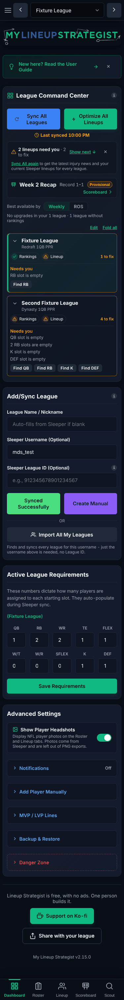 | 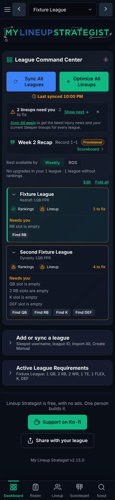 | 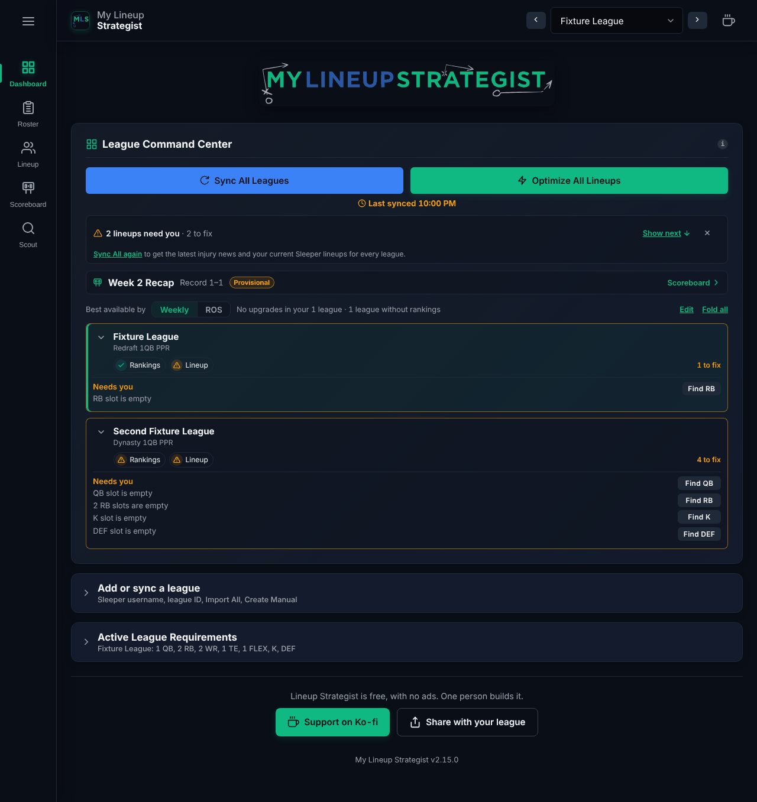 |

### Option 1 (recommended): tidy in place, with jump chips — runbook (b) + (c)

- **Occasional tools fold** to one line, remembered like the Scoreboard's folds: the Matchup Simulator (Lineup), the
  Trade Finder (Scout), the SoS card (Roster). Open, they are exactly today's cards.
- **A jump row** at the top of the two tabs with two jobs: Scout (**Waivers · Trade Analyzer · Trade Finder**) and
  Lineup (**Lineup · Bench · Early Games · Simulator**). Material 3 filter-chip shape (8px corners, 32px tall, 48px
  target), sticky under the header, the chip of the section in view highlighted. A tap scrolls (and opens a folded one).
  It's a scroll aid, not navigation: one page, swipes unchanged, screen readers get a `nav` "Jump to" with links.
- From 1200px, once M12 puts Waivers beside the Trade Analyzer, the Scout row has nothing to jump to and hides.

Sizes at 375px: **Scout 2,076 → about 1,410px** (the Trade Analyzer one tap from the top, today 1.5 screens down);
**Lineup 2,810 → about 2,280px**; Roster 2,502 → about 2,350px.

| Scout today, 375px | Scout, option 1, 375px | Lineup, option 1, 375px |
|---|---|---|
| 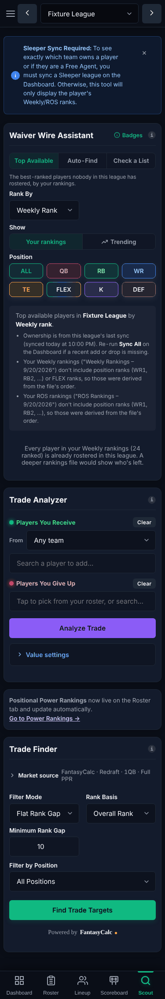 | 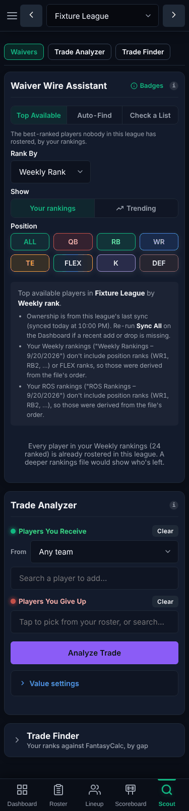 | 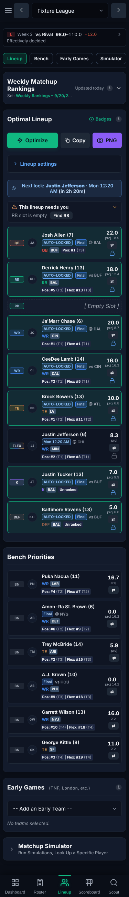 |

At 1280px: [Scout](organization/opt1-scout-1280.png), [Lineup](organization/opt1-lineup-1280.png).

**For:** no new level, no extra tap for any weekly tool, swipes keep working, five destinations, the cheapest (CSS, one
small shared module, a few folds). Every weekly card stays where the owner finds it today. **Against:** Scout is still
one scroll (1,410px, about two screens); it treats the symptom (length), not "two jobs on one tab".

### Option 2: secondary tabs inside Scout — runbook (a)

- Scout gets a tab row: **Waivers | Trades | Market** (Waiver Wire Assistant; Trade Analyzer; Trade Finder), Material 3
  secondary-tab style (text, a 2px green line under the active one, a divider), remembered per app, deep-linkable
  (`#scout/trades`). Badges fit on them (M3 tabs take badges: a count of upgrades on Waivers, after S34).
- Lineup could get **Lineup | Simulator** the same way; the rest stay single pages.
- The base above for the Dashboard.

Sizes at 375px: Waivers about 1,170px, Trades under 650px, Market about 550px.

| Scout, option 2: Waivers, 375px | Scout, option 2: Trades, 375px | Trades, 1280px |
|---|---|---|
| 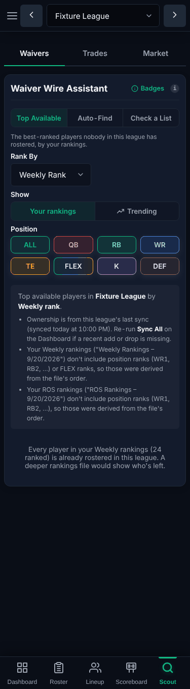 | 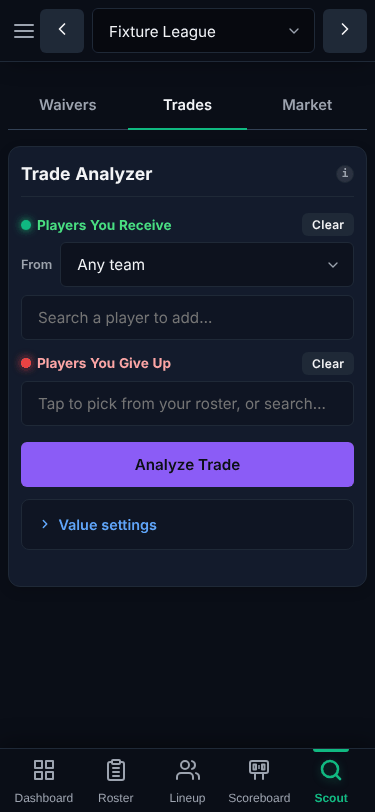 | 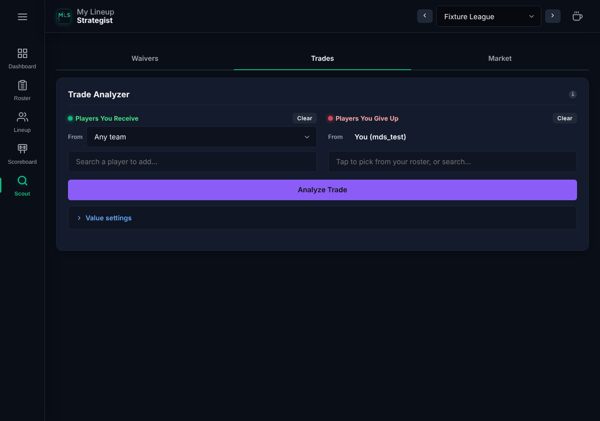 |

[Waivers at 1280px](organization/opt2-scout-waivers-1280.png).

**For:** each page is short and has one job; a clean place for each new Scout card (S34, S35). **Against:** the owner
uses both Waivers and Trades weekly, so one of them is always a tap further than today; swipes now mean two things
(Material 3 says tabs swipe between themselves; the app swipes between destinations): either the inner tabs don't swipe
(against Material 3's tabs) or swiping on Scout stops reaching the other destinations; on computers, M12 wants Waivers
and the Trade Analyzer side by side, which makes the tabs pointless there (two layouts to keep); the Scout code that
S20 loads on first use would need its split per inner tab.

### Option 3: trading moves to the Roster tab (renamed Team); Scout becomes Waivers — runbook (b), further

- The Trade Analyzer and the Trade Finder (folded) move under Positional Power Rankings, where you judge your roster
  against the league (S29's "what your last trade did" is already there). The tab becomes **Team**; Scout becomes
  **Waivers** (same icon or a new one). A jump row on Team: **Roster · Power Rankings · Trade Analyzer · Trade Finder**.
- The base above for the Dashboard; the SoS card folded on Team.

Sizes at 375px: **Team about 2,960px** (longer than any tab today), **Waivers about 1,100px**.

| Team, option 3, 375px | Waivers, option 3, 375px |
|---|---|
| 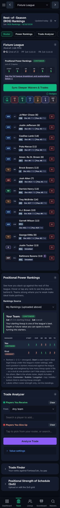 | 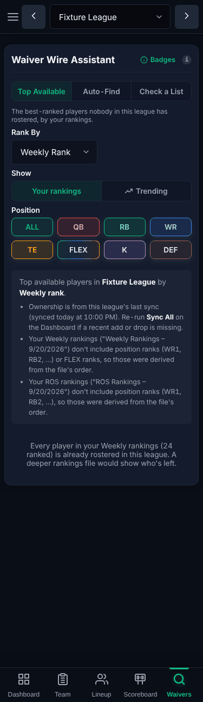 |

At 1280px: [Team](organization/opt3-team-1280.png), [Waivers](organization/opt3-waivers-1280.png).

**For:** each destination names one job (your team; the waiver wire), and on computers M12's Roster pane (the list
beside Power Rankings) could hold the Trade Analyzer too. **Against:** it moves a weekly tool the owner knows, renames
two tabs (the Guide, the shortcuts, `MLS_TABS` in tests, the tab hash with an old `#scout` redirect, 14 or more
screenshots), and makes the Roster tab the new longest tab; the Trade Analyzer's picker uses every league's rosters, not
just yours, so "Team" undersells it.

### Option 4 (not recommended): a sixth destination behind "More" — runbook (d)

Material 3 says no for the bar ("Avoid putting more than five navigation items"), and the rail already has a "More"
(S26). A "More" tab on phones would hide whatever goes in it (it can't carry M10's badge usefully) and adds a tap. No
mock-up; if the owner wants it anyway, the S26 drawer is where extra destinations already live.

## 5. How each option fits the open cards

| Card | Option 1 (tidy + jump chips) | Option 2 (Scout secondary tabs) | Option 3 (trading to Team) |
|---|---|---|---|
| **S45** Settings page (agreed, weeks 12–13) | The base. Build S45 first; option 1's cards after it. | Same | Same |
| **M10** badges on the bar | Unchanged: five destinations, badges on Dashboard and Lineup. | Inner tabs can carry their own badge (Waivers: upgrades after S34). | Unchanged; the Waivers destination is a natural place for an upgrades badge. |
| **M12** two panes, Lineup Strategist | Fits best: the jump rows hide from 1200px where the panes show the sections side by side. | Conflicts: panes want Waivers beside Trades; the tabs would hide from 1200px (two layouts). | Fits: Team's pane holds Power Rankings and the Trade Analyzer beside the roster. |
| **M13** two panes, Draft Strategist | No effect (Draft Strategist's bar unchanged). | No effect | No effect |
| **M15** standard expanded rail (≥1600px) | No effect | No effect | No effect |
| **S26** rail (merged) | No effect: same destinations. | No effect on the rail; the inner tabs sit in the page. | Two labels change in the bar, rail and drawer. |
| **S32** phone rows (Lineup, Roster) | Independent; shorter rows make Lineup shorter still. | Independent | Independent; Team gets longer, S32 offsets some of it. |
| **U2** onboarding | Fewer things to point at (the setup cards fold after setup; a tour points at Add a league while empty). | The tour has to point inside Scout's tabs. | Renamed tabs to teach; old screenshots in the Guide change. |
| **S34, S35** (waiver claim or free agent, FAAB bid) | Into the Waiver Wire Assistant, as planned. | Into the Waivers tab. | Into the Waivers destination. |
| **S36, S37** (Monday Night Miracle) | New Scoreboard folds, as planned. | Same | Same |
| **S20** (load Scout and the Simulator on first use) | Unchanged; a folded Simulator could load on first unfold. | Loads per inner tab (more work). | Trade code loads with the Team tab, so not deferred any more. |
| **S42** (Draft Strategist's Dashboard redo) | Takes the same rule: setup steps fold once done. | Same | Same |

## 6. Recommendation

**Option 1, tidy in place**, for four reasons: the owner uses almost every weekly card, so nothing should get further
away; most of the length is setup and signposts, which the base removes without adding a level; it keeps the five
destinations and the swipes; and on computers M12's panes, not more navigation, are Material 3's answer to "long", which
option 1 is built to step aside for. If Umami's `Tool` event later shows the Trade Analyzer used as much as waivers by
everyone, option 3 can follow on top of it (the jump rows and folds carry over).

**Proposed build cards (option 1)**, for the runbook once the owner picks; sizes like the runbook's:
1. **Dashboard and Scout tidy** (~10k tok, after S45): Add/Sync League and Active League Requirements fold to one line
   once a league exists (open while there is none; remembered); the Sleeper Sync banner shows only while no Sleeper
   league is synced (its dismiss key stays); retire the two signpost cards and their `goTo…` actions if nothing else uses
   them. Specs for the empty and synced states; re-takes `mls-league-setup` and `mls-league-scout`, `mls-league-lineup`
   (both widths); `mls-empty-setup` stays identical.
2. **Fold the occasional tools** (~10k tok): the Matchup Simulator, the Trade Finder and the SoS card fold like the
   Scoreboard's sections (one new `mls_` key in keys.js for their state, or one shared map); the Guide's steps 3, 6 and
   10 say so. Pairs naturally with S20 (load on first unfold).
3. **Jump chips on Scout and Lineup** (~12k tok): `js/shared/ui/jumpList.js` (in PRECACHE_ASSETS), sticky under the
   header, IntersectionObserver for the highlighted chip, a tap scrolls and opens a folded target, Reduce Motion jumps
   without the smooth scroll; `nav aria-label="Jump to"`; hidden from 1200px once M12 lands (until then shown on every
   width); a chip is a new symbol, so a line in `js/mls/legend.js` if it counts as a badge (it doesn't carry meaning, so
   probably not). Specs: the jump, the highlight, a folded target opening, keyboard.
4. **Umami: Tab, Tool and Section events** (~6k tok, beside anything): attributes as in section 2, the Guides' and
   README's privacy lines updated, a spec that the attributes are on the buttons.

Draft Strategist needs no card from U1: S45 and S42 cover its Dashboard; M13 its Tracker.
