# K1: Ko-fi tips, a polite ask, supporter perks and sharing (research)

Runbook card K1, researched 2026-11-06 (NFL week 10). No app code: this file, the mock-ups in
[`support/`](support/) and the LOG entry. The build cards (K2 onward) are written from the owner's picks.

**The goal, from the owner (2026-11-02).** The site costs about $10 a year (the domain) and a lot of time. A little
pocket money would be nice, with **no ads and no paywall** that locks features. Ko-fi (ko-fi.com/btrerise) shows today
only where weekly users rarely look. Decided already: the post-draft ask in Draft Strategist, counts kept in
localStorage, the polite rules and the seasonality. The worry: an ask right after Optimize on a Sunday lands while
you're setting lineups on Sleeper against the clock.

**How the mock-ups were made.** A Playwright script outside the repo opened the real pages from the local test server
(the test fixtures: a Sleeper league, a five-pick draft), added mock markup and a mock stylesheet built from the site's
own tokens (`--primary-green`, `--card-bg`, `--text-muted`, Outfit), and took screenshots at 375 and 1280px. Nothing in
`css/`, `js/` or the pages changed. Ko-fi's PNG can't load in the test browser, so "today" draws a box of the same size.

## In short: what I recommend

| # | Question | My recommendation | Why |
|---|---|---|---|
| 1 | Finding Ko-fi | Our own "Support on Ko-fi" button (inline SVG cup, our green) in place of Ko-fi's PNG, everywhere it shows today; an "About this project" note at the top of both Guides; a small cup icon in the header. **No Ko-fi floating widget.** | Ko-fi's help pages say you may "create your own" button. Our button loads nothing from a third party, works offline, and can't show as a broken image. The header icon is the only placement a weekly user sees every visit. |
| 2 | When to ask | **Lineup Strategist: when the week turns Final** on the Scoreboard (Monday night or Tuesday), plus **one thank-you after your championship week**. Draft Strategist: **when the whole draft is complete** (your pick was too early: the board is still moving), on the Team tab. Ship the Lineup Final-week ask first. | Final week: results are in and no lineup locks for days (waiver claims are due, but the card sits under the Week Recap, not in the Waiver Wire), and it's after the app did a week's work. Waiver and Trade runs happen under deadlines and mid-task, so they count as moments but never show the ask. |
| 3 | The polite rules | One pure function, `shouldAsk(state, now, context)`, unit-tested. First ask after **1 completed draft** (Draft) or **2 Final weeks seen** (Lineup, this season; 3 from next season). **Once per app per season**, plus the end-of-season thank-you if the last ask was 30+ days ago. "Maybe later": quiet 30 days (Lineup) or until next season (Draft). "I already chipped in": never again on this device. One key per app. | Counts what mattered, not page opens. N=2 this season because K4 can't ship before week 12, and the regular season ends in week 17. |
| 4 | Perks and membership | **Not yet.** Start with tips only. If you want a membership later: one tier, **$5 a month**, with a thank-you in the Guide, a vote on what gets built next, early preview links and, after M6 and M14, two extra accent colors on the honor system. No webhook checking. | Free-plan tips cost no Ko-fi fee (memberships cost 5%), and every perk here costs you upkeep. Prove people tip first. |
| 5 | Sharing | A **"Share with your league"** button (the phone's share sheet; "Link copied" on computers) in the drawer, the Guide note and the ask card; **"Share image…" as the third item of M9's Share split button**; **1200×630 PNG link previews** for all three pages, and the fixes to `/lineup/`'s tags; a `?ref=share` tag counted by the Umami loader. | Sharing costs nobody money and grows the site, which grows tips. Group chats are where leagues talk, and today a shared link shows an SVG most chat apps won't preview. |
| 6 | All at once or in stages | **Stages**, one change at a time, two weeks of Umami and Ko-fi numbers between them: K2 + K3 now; K4 by week 12; K6 before August; K5 after M9; K7 only if you decide on a membership. | Each stage tells you whether the next is worth it. Stage 1 alone shows whether making Ko-fi visible is enough. |

Your picks are listed under [Decisions for you](#decisions-for-you) at the end.

---

## 1. Finding Ko-fi

### Where it shows today

| Place | Page | Markup | Who sees it |
|---|---|---|---|
| Drawer footer (`.menu-footer`), under the feedback form | `/`, `/lineup/`, `/t-score/` | `<a class="kofi-link">` | Only after opening the menu and scrolling past the feedback form. On computers (S26) the menu is the expanded rail, opened from its top button. |
| `.hero-kofi` | `/` (index.html:577) | the same PNG; the link has no `rel="noopener noreferrer"` | The end of the Dashboard, under Reset Controls, above the version. |
| `.hero-kofi` | `/lineup/` (lineup/index.html:500) | the same, no `rel` | The end of the Dashboard, under Danger Zone. |

Styles: `css/base.css` "Footer & Ko-fi" (`.menu-footer`, `.kofi-link`, `.kofi-img`) and `.hero-kofi`. The PNG comes from
Ko-fi's server: S17 flagged its short cache life (performance.md, "Cache lifetimes, 5 KiB, Ko-fi's image"). Offline, in
the installed app or behind a strict blocker it shows as alt text. The Lineup mock-up below shows that: the test
browser blocks third parties, as a strict blocker would.

Its alt text says "Buy Me a Coffee", which is the name of a rival service (buymeacoffee.com), so a screen reader
announces the wrong site.

### Can we draw our own button? (Ko-fi's brand rules)

Ko-fi's help centre, as quoted in search results (ko-fi.com and help.ko-fi.com show this session a Cloudflare "Just a
moment..." check, so I couldn't read them directly; please open the two links to confirm):
- ["Can I use the Ko-fi logo to promote my page?"](https://help.ko-fi.com/hc/en-us/articles/360007169493-Can-I-use-the-Ko-fi-logo-to-promote-my-page):
  creators can download the Ko-fi logo, cup and badges "to help promote your Ko-fi page", designs must follow Ko-fi's
  content policy, and "as long as your design is in line with our guidelines, you're free to get creative".
- ["Adding a Ko-fi Button to your WordPress site or blog"](https://help.ko-fi.com/hc/en-us/articles/115004002614):
  on the personal plan "you can simply download an image from our brand assets or create your own".

So a button of our own is allowed. The mock-ups go further and **use no Ko-fi artwork at all**: Feather's `coffee`
icon (the site's icon family), our green, and Ko-fi's name only as text ("Support on Ko-fi"). That avoids any question
about altering their logo. Ko-fi's own "Ko-fi cup" logo is not used.

### Mock-ups

**Our button in place of the PNG** (Draft Strategist's Dashboard foot; the same in Lineup Strategist's):

| Today (the PNG, drawn as a box) | Ours |
|---|---|
| 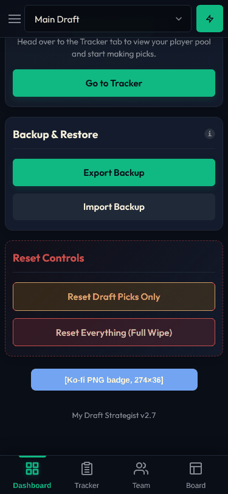 | 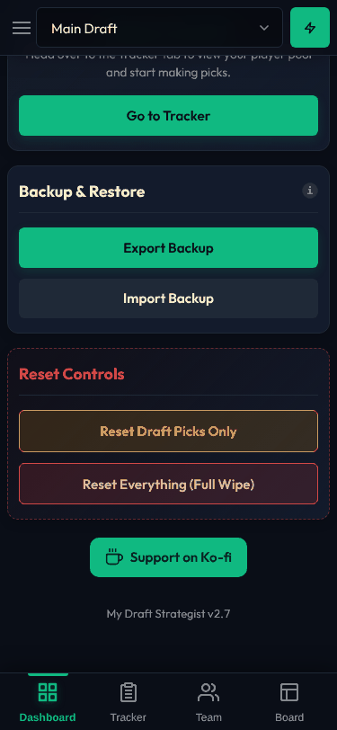 |
| 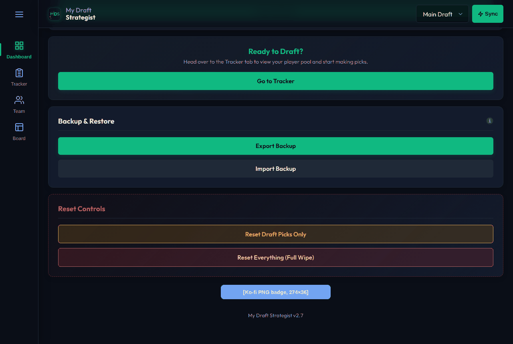 | 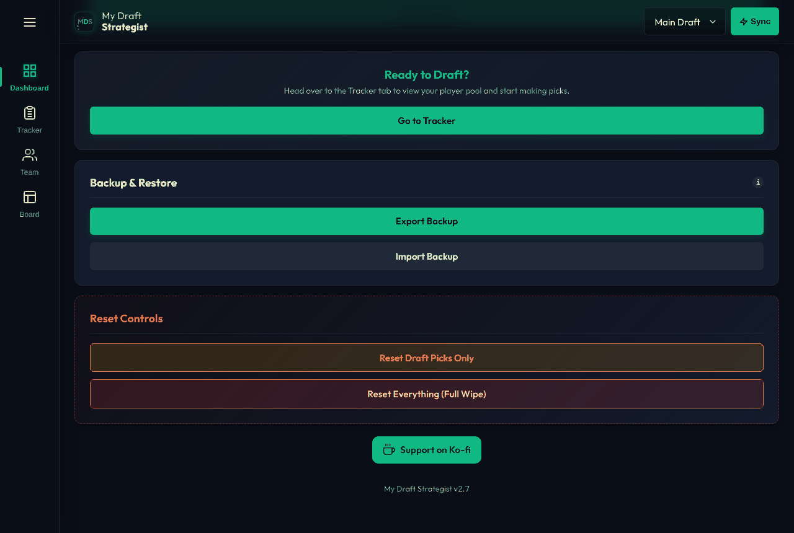 |

**The drawer**, with our button and a line under it, and a new "Share this site" item above the feedback form
(Draft Strategist; Lineup Strategist and T-Score's drawers are the same markup):

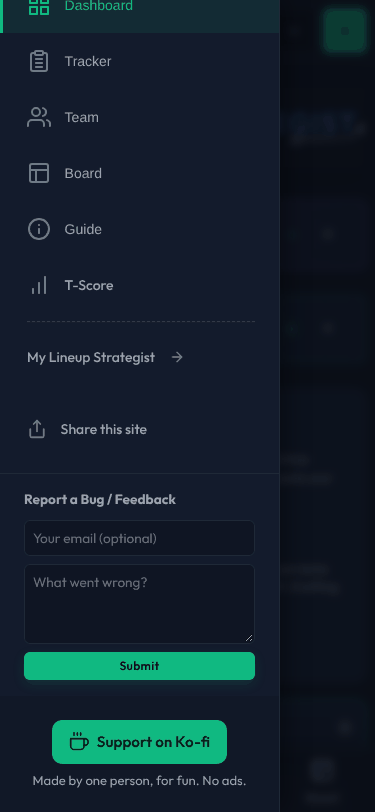
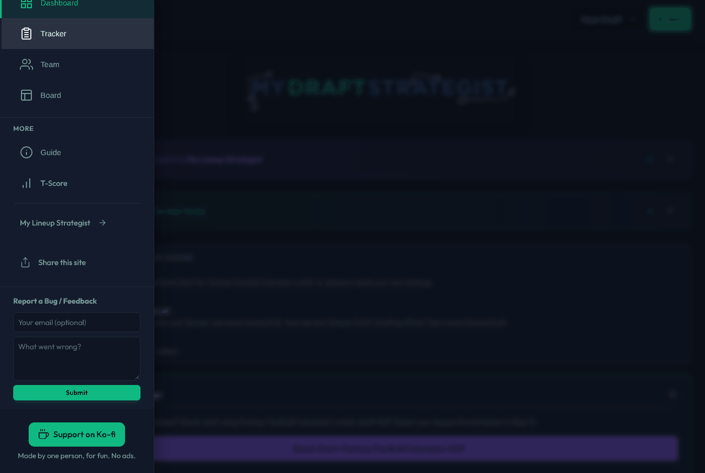

**A cup icon in the header.** On phones it sits beside the menu button (the logo is already hidden there when a league
or draft picker shows). On computers the menu button is in the rail, so the cup goes at the header's right end, after
the league picker. It's a link with `aria-label="Support this site on Ko-fi"` and a tooltip, 44px like the other header
buttons (48px once M2's sizes apply), the icon muted until hovered so it doesn't compete with the picker.

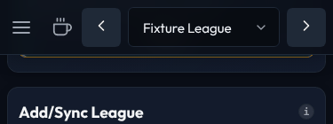
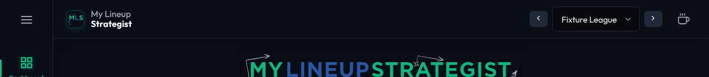

**"About this project" in each Guide**, right under the intro (Lineup Strategist's shown; Draft Strategist's says the
same; T-Score's would be one line at the end of The Research, like A1's Visitor Counts line):

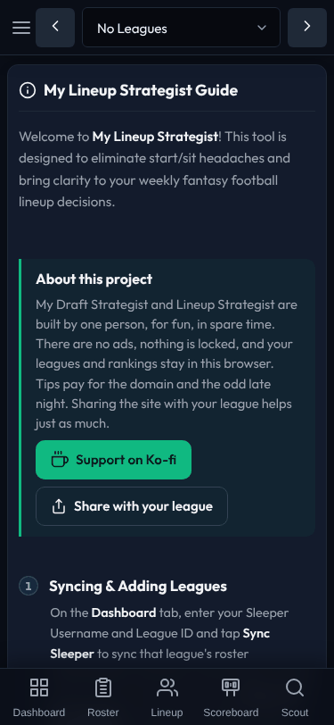
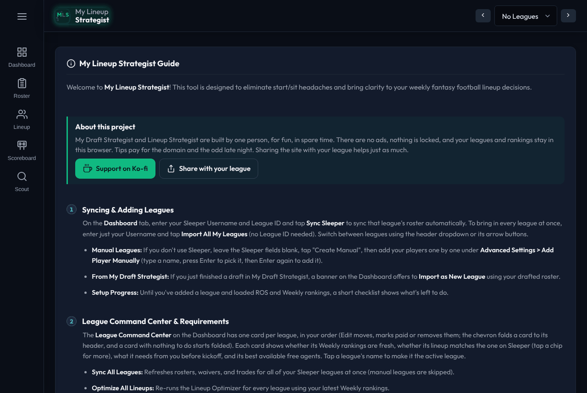

Suggested text: *"My Draft Strategist and Lineup Strategist are built by one person, for fun, in spare time. There are
no ads, nothing is locked, and your leagues and rankings stay in this browser. Tips pay for the domain and the odd late
night. Sharing the site with your league helps just as much."*

**A line at the foot of the Dashboard** (Lineup Strategist; it replaces the PNG there, since `.hero-kofi` is already
at the foot of the Dashboard, under Danger Zone):

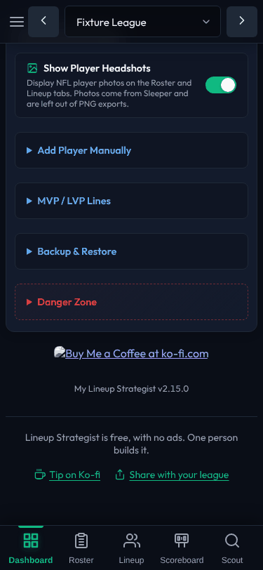
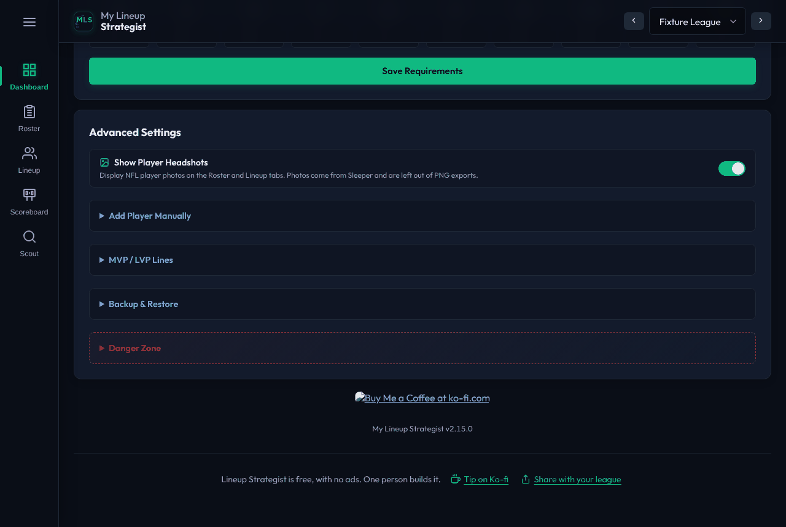

The 375px shot also shows today's PNG above it, broken as a blocker leaves it. In the build the line replaces it: one
foot, not two.

**Recommendation:** all four. The button swap and the Guide note are the low-key basics; the header icon is the only
one a weekly user sees without looking for it. If the header feels crowded on phones (it holds the menu, the cup, the
league picker and two arrows at 375px), the fallback is the drawer and the Dashboard foot only.

### Ko-fi's floating widget: no

Ko-fi's "floating button" widget is a script from `storage.ko-fi.com` that draws a button in a corner of every page and
opens Ko-fi in an overlay. Against it:
- **A third-party script on every page**, against S17's speed work (fonts self-hosted, third parties loaded late) and
  A1's single third-party script. It also loads on Sunday mornings on mobile data, when the app should be quickest.
- **It floats over the page**: on phones a corner button sits over the bottom bar or a row's controls. "Never over a
  control" is one of the polite rules.
- **It's always there**, which is the opposite of "once in a while". It also reaches T-Score, which has no account.
- Our own button does the same job (a link to ko-fi.com/btrerise; Ko-fi's page handles payment) with no script.

---

## 2. When to ask

### The quiet-window rule (everywhere, before any moment counts)

The ask never shows:
- from **3 hours before the kickoff of any game with one of your starters** (in any synced league) **until that game is
  final**: `State.gameTimesByTeam` (kickoff ISO per team), `State.gamesByTeam[team].state` (`'pre' | 'in' | 'post'`,
  ESPN's), `hasKickedOff(player)` in `js/mls/lineup/gameInfo.js`;
- while a **Sleeper draft is live**: in Draft Strategist, live sync on (`State.autoSyncTimer`) and the draft not
  complete;
- on the **first visits**: no count yet, so the threshold below handles it;
- as a **modal**, a toast or anything that covers a control: it's a card in the page's flow, after the content it
  follows, never over the board, a lineup or a button;
- when the page loaded without the data to check the window (no kickoff times yet): no data, no ask.

### The moments

| Moment | App | How often | Calm? | Verdict |
|---|---|---|---|---|
| **The draft is complete**: every pick made. Sleeper: the draft's `status` is `'complete'` (Sleeper's draft object has it; `sleeperSync.js` fetches the draft but doesn't read `status` today) or picks = teams × rounds. Manual: `draftedPlayers.length` = teams × rounds. | Draft | 1 to 3 times a user, August to early September | **Calm.** Nothing is due; the person is usually on the Team tab reading the Draft Recap, which appears once your roster is full (`renderDraftRecap`, `js/mds/recap.js`). | **Ask** (your pick). On the Team tab, under the Draft Recap card. Once per draft id. |
| Your last pick made (roster full, `myTeam.length >= limits.TOTAL`) but the draft still going | Draft | Same | **Not calm**: other teams are still picking and live sync keeps redrawing the board. | Wait for complete. If a manual draft is never finished to the last pick (people stop tracking once their roster is full), fall back to roster full **and** live sync off **and** 10 minutes without a new pick. |
| Export Team image saved | Draft | Once a draft, for some | Calm, a moment of pride. | Count it; show **Share**, not the ask. |
| Rankings import, Quick-Start | Draft | Before the draft | Prep, often against the draft clock. | Never. |
| Mid-draft | Draft | | Crunch. | Never. |
| **The week turns Final** on the Scoreboard (S21's Provisional → Final; the Week Recap stays up through Tuesday, S21 follow-up) | Lineup | Once a week, about 14 times a season | **The calmest weekly moment**: results are in and no lineup locks until Thursday night. Waiver claims are being made (submitted Tuesday, processed Wednesday in most leagues), so the card stays out of the Waiver Wire and sits under the Week Recap. A winning week is a natural "glad it helped". | **Ask, and ship this first.** Under the Week Recap card, after its Export button, never between the tiles. The tone follows the week: a winning week "Glad it helped", otherwise "On to next week". |
| **After your championship week** (the last week your leagues play: Sleeper's `playoff_week_start` and the playoff rounds, or Sleeper's league status `'complete'`; week 17 for most leagues) | Lineup | Once a season | **Calm, and the best moment for a thank-you**: the season's over. | **Thank-you card**, once, even after a "Maybe later" (but not after "I already chipped in"), if the last ask was 30+ days ago. |
| Waiver Wire run (Auto-Find, Top Available) on Tuesday or Wednesday | Lineup | Weekly | **Mid-task**: you're about to claim on Sleeper, and waivers process early Wednesday in most leagues. | **Count it** as a tool used; don't ask. |
| Trade Analyzer run | Lineup | Irregular, peaks before deadlines (weeks 11 to 13) | **Mid-negotiation**, often against a trade deadline. | **Count it**; don't ask. |
| After Optimize or Optimize All, on a Sunday | Lineup | Weekly, many times | **Crunch** (your worry): lineups are being set on Sleeper against the clock. | **Never.** The quiet window blocks it anyway. |
| Opening the Dashboard on a weekday | Lineup | Many times | Calm, but a page open, not a moment that mattered. | Never. |

**Which first:** Lineup Strategist's Final week. It's the season now (week 10), it happens weekly, and its timing is the
safest there is. The post-draft ask can't help anyone until August.

### Mock-ups

**Lineup Strategist, under the Week Recap once the week is Final** (Tuesday, the fixture week, every game over):

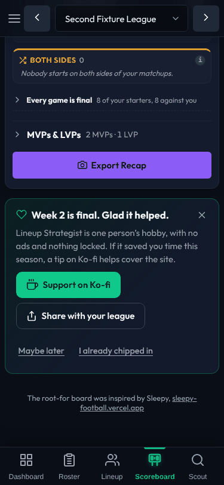
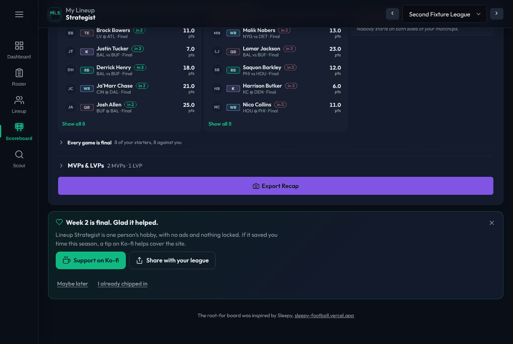

**Draft Strategist, on the Team tab once the draft is complete** (the fixture draft has five picks, so this shows the
card's look; in the build it sits under the Draft Recap card, which only appears with a full roster):

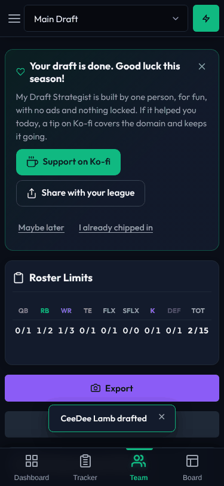
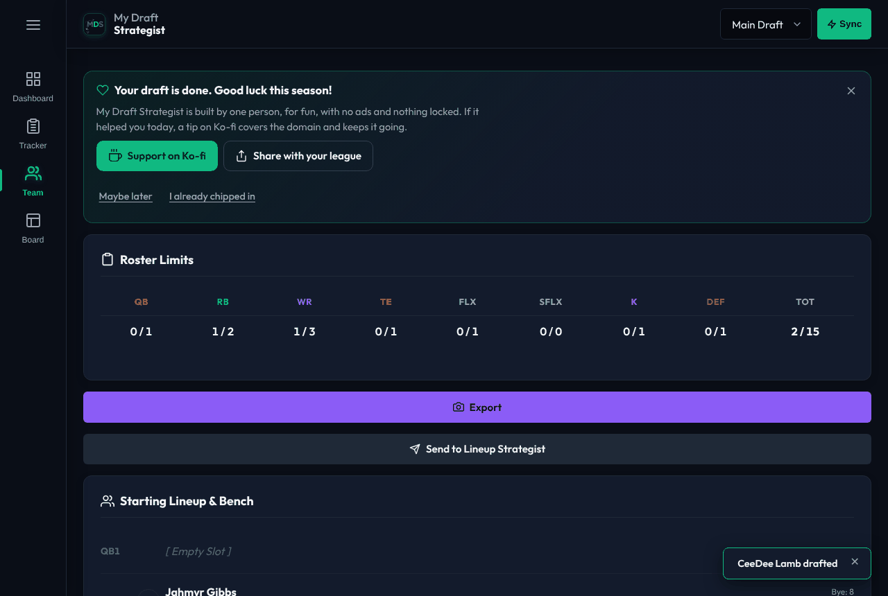

The card: a heart icon and a short title; two sentences (who builds it, what a tip pays for); **Support on Ko-fi**
(filled green, the one main action), **Share with your league** (outlined); then two quiet text buttons, **Maybe
later** and **I already chipped in**; and a × in the corner, which means "Maybe later". All targets 44px or more.
Suggested words:
- Draft: *"Your draft is done. Good luck this season! My Draft Strategist is built by one person, for fun, with no ads
  and nothing locked. If it helped you today, a tip on Ko-fi covers the domain and keeps it going."*
- Lineup, Final week: *"Week 9 is final. Glad it helped. Lineup Strategist is one person's hobby, with no ads and
  nothing locked. If it saved you time this season, a tip on Ko-fi helps cover the site."*
- Lineup, thank-you: *"That's a wrap on the season. Thanks for setting your lineups here. If it helped, a tip on Ko-fi
  pays for next season's domain; sharing it with your league helps too."*

---

## 3. The polite rules

One pure function in a shared module (`js/shared/support/askRules.js` is my suggestion), with no DOM and no storage
access, so `tests/unit/` can test every case with a fixed date:

```js
// state: what the app's key holds (below). now: a Date. ctx: what the page knows right now.
// Returns { show: false } or { show: true, kind: 'ask' | 'thanks' }.
shouldAsk(state, now, {
  app: 'mds' | 'mls',
  season,           // NFL season year (Sleeper's state, or the date: August starts a new one)
  moment,           // 'draftComplete' | 'weekFinal' | 'seasonOver'
  momentId,         // draft id, or "2026-w9": once per draft, once per week
  quiet,            // true inside the quiet window (computed by the page from kickoff times / live sync)
  week,             // NFL week, for Lineup's season window
})
```

**What counts.** Moments that mattered, never page opens:
- Draft: drafts completed (distinct draft ids). Exports and Share taps are counted for A1-style curiosity only.
- Lineup: weeks seen Final (distinct weeks), Waiver Wire runs and Trade Analyzer runs (counted, never asked on).

**When the first ask comes.**
- Draft: **after the 1st completed draft**. Draft season is five weeks, most people draft once to three times, and you
  picked this moment. A brand-new user who drafts with the app has used it properly by then.
- Lineup: **after the 2nd Final week seen this season** (3rd from next season). K4 can ship by about week 12, so N=3
  would put the first ask in week 15, the playoffs, and leave little season.

**How often.**
- **At most one ask per app per season**, plus Lineup's end-of-season thank-you if the last ask was 30 or more days
  earlier. Never two in 30 days. Draft and Lineup count separately (different people use them, and a backup restores
  one app at a time).
- **Maybe later** (or ×): quiet for 30 days in Lineup; **15 days in Draft** (owner, 2026-11-07: draft season runs about
  two months, with several drafts).
- **Draft Strategist: at most two asks per draft season**, each after a completed draft and at least 15 days apart
  (owner's choice); the "once per app per season" above is Lineup's rule.
- **I already chipped in**: never again on this device, in that app (honor system). It's also the switch K7 would use
  for supporter perks, if you go that way: one honest answer, no codes.
- **Support on Ko-fi** tapped: counts as asked; don't ask again this season.

**Seasonality.** Draft: **15 July to 15 September** only (widened from 1 August, owner 2026-11-07) (by the date: drafts happen before Sleeper's week 1, and the
latest leagues draft the week of the opener). Lineup: **from week 4 to the end of your season** (Sleeper's regular
season, `state.season_type === 'regular'`, and the playoffs), plus the thank-you. Nothing in the off-season.

**Storage** (all in `js/shared/storage/keys.js`, so Backup carries them and the resets clear them):
- `KEYS.mds.supportAsk` = `mds_support_ask` and `KEYS.mls.supportAsk` = `mls_support_ask`, one JSON object each:
  `{ season, moments: { drafts: [...ids] | weeks: [...], waiver: n, trade: n }, lastAskAt, asksThisSeason,
  snoozeUntil, chippedIn, thanked }`. One key per app keeps the function's input in one place. Each season resets the
  counts but keeps `chippedIn`.
- A new device or a cleared browser starts at zero: it may ask once more after the threshold. I think that's fine at
  one ask a season; restoring a backup brings the answer back. A site-wide "chipped in" (a `shared_` key, like A1's
  opt-out) would cover both apps but would survive Factory Reset and not travel in backups, which is the opposite of
  what a person expects from those; not recommended.

**Measuring.** Umami custom events, each a `data-umami-event` attribute (no code, A1): `Ko-fi` with
`data-umami-event-where` (header, drawer, guide, foot, ask-final, ask-draft, thanks), `Ask shown`, `Maybe later`,
`Chipped in`, `Share` with `where`. The Guide's "Visitor Counts" line (A1) then needs one more clause: "and taps on the
Ko-fi and Share buttons". Umami's free plan counts events against the same 100K a month; at this size that's nothing.

---

## 4. Supporter perks and a Ko-fi membership

### Perks that take nothing away

| Perk | Build | Upkeep | Worth it? |
|---|---|---|---|
| **A "Thanks to supporters" list in the Guide** (opt-in names, edited by hand in the page) | Tiny: a list in both Guides | You add a name when someone asks | **Yes**, the cheapest real thank-you. |
| **A vote on what gets built next** (Ko-fi posts or polls) | None | A post when you plan the next cards | **Yes**: free, and useful to you. |
| **Early access**: a branch preview link (`*.pages.dev`) posted to supporters on Ko-fi | None | A post per preview | **Yes, carefully**: a preview is another origin, so it has none of the person's leagues or rankings (they'd sync or restore a backup there); A1 doesn't count previews, which is right. Say "preview, may break". |
| **Extra color accents** (one or two alternatives to green; the current look stays the default) | Medium: an accent switch in Settings, a set of CSS variables, screenshot tests for each | Every visual card (M6 contrast, M14 surface tones touch the same variables) must keep the accents working | **Later**, after M6 and M14, on the honor switch. |
| **A supporter mark** in the menu or on export images | Small | A badge means a legend line (`tests/unit/badgeLegend.test.mjs`); on an image, leaguemates see it | **Maybe**: on export images it doubles as word of mouth. Low priority. |
| **More export image styles** | Large: html2canvas has quirks every time (F5's gradients, S14's borders) | High | **No.** |

**How a perk turns on with no server.** Two ways, both trust-based:
- **The honor switch**: "I support on Ko-fi" in Settings, the same flag as the ask's "I already chipped in".
- **A code** in Ko-fi's thank-you or membership welcome message, typed into Settings. It feels more like a reward,
  but it's shareable and changes nothing real, and it needs a box and a check in the app.

For cosmetic perks the honor switch is enough (recommended).

**Real checking (Ko-fi's webhook): not worth it.** Ko-fi can POST each payment to a URL you give it (form field `data`,
a JSON with `verification_token`, `type` = Donation / Subscription / Shop Order / Commission, `email`, `tier_name`,
`is_subscription_payment`, `is_first_subscription_payment`, `kofi_transaction_id`; per community write-ups such as
[this gist](https://gist.github.com/carlansell94/a21163b1eaf8dd326e7529694ca90042) and
[n8n's template](https://n8n.io/workflows/3186); Ko-fi's own docs page wasn't reachable). Building on it means: a
Pages Function to receive it, storage (D1 or KV) of supporters' emails or codes, which is personal data (a privacy
note, deletion on request), and a way for a browser to prove it's that supporter (a code by email, so an email sender
too), plus monthly expiry for members. That's three or four cards and something to keep running, all to guard
cosmetic perks anyone could unlock in the browser's DevTools anyway (as you found: on a static site any lock can be
undone). Not recommended.

### Ko-fi: fees, membership features (needs your check)

I couldn't read ko-fi.com or its help centre directly: both answer this session with Cloudflare's bot check, and I
didn't try to get around it. Everything below comes from search results quoting Ko-fi's help pages, plus third-party
reviews from 2026. **Please confirm on your Ko-fi dashboard** before deciding; you have the account.

| Item | Free plan | Ko-fi Gold | Sources |
|---|---|---|---|
| **One-time tips** | **0% Ko-fi fee**; PayPal or Stripe's own fee on top (about 2.9% + $0.30 in the US) | 0% | [Ko-fi: Does Ko-fi take a fee?](https://help.ko-fi.com/hc/en-us/articles/360002506494), [schoolmaker.com, Ko-fi pricing 2026](https://schoolmaker.com/blog/ko-fi-pricing), [builtbyfoundry.io, Ko-fi review 2026](https://www.builtbyfoundry.io/blog/ko-fi-review-2026-is-it-worth-it) |
| **Memberships, monthly tips, shop, commissions** | **5%** + the processor's fee | 0% + the processor's fee | the same; [Ko-fi: Memberships and tiers](https://help.ko-fi.com/hc/en-us/articles/4402945994001) |
| **Gold's price** | | **$12 a month** in the most recent sources (older pages say $6 to $8; annual Gold reportedly no longer offered to new sign-ups). Pays for itself above about **$240 a month** of fee-bearing sales. One source says Ko-fi's Gold page now opens with "You no longer need Ko-fi Gold". | [bestcreatorplatforms.com](https://bestcreatorplatforms.com/reviews/ko-fi/), [inkfluenceai.com](https://www.inkfluenceai.com/blog/ko-fi-shop-for-authors-2026), [schoolmaker.com](https://schoolmaker.com/blog/ko-fi-pricing) |
| **A possible 5% on tips** | One October 2026 source mentions a "Standard" setting under which one-time tips carry 5% too; others say tips are always 0%. **Check your fee setting.** | | [schoolmaker.com](https://schoolmaker.com/blog/ko-fi-pricing) |
| **Membership tiers** | Memberships, then Membership Mode: "Membership tiers" (tiers at different prices, with perks such as Discord roles) or "Simple monthly tips" (no tiers) | | [Ko-fi: Memberships and tiers](https://help.ko-fi.com/hc/en-us/articles/4402945994001), [Ko-fi: Memberships with monthly supporters](https://help.ko-fi.com/hc/en-us/articles/4405133970065), [ko-fi.com/memberships](https://ko-fi.com/memberships) |
| **Yearly billing** | **Not confirmed** from Ko-fi's pages. | | |
| **Welcome message** to new members | **Not confirmed** (no result covered it). | | |
| **Posts and polls** (supporter-only) | Reported by a secondary source (locked posts, polls, Discord). | | [subger.com overview](https://subger.com/en/service/ko-fi) |

Gold is not worth it here: at this size the 5% on a few memberships is cents, against $12 a month.

### If you do start a membership

- **One tier, $5 a month**, called something like "Season supporter". At $3, the processor's fixed $0.30 plus 5% takes
  about 15%; at $5 about 11%. If Ko-fi offers yearly billing, $20 a year (one price per season) is kinder still.
- **What it gets:** your name in the Guide's thank-you list (if you want it there), a vote on what gets built next
  (Ko-fi polls), early preview links, and, after M6 and M14, the extra accents (on the honor switch, so a one-time
  tipper gets them too: nothing is withheld from anyone who says they chipped in).
- **Or no tiers at all**: "Simple monthly tips" lets people give monthly with no promise from you. That's the lightest
  option, and it doesn't make the site look like it sells anything.

**My recommendation:** tips only for now (stages 1 to 3). Decide on a membership next summer, with a season of Umami
and Ko-fi numbers in hand.

---

## 5. Making the site easy to share

### A "Share with your league" button

- **How:** `navigator.share({ title, text, url })` where the browser has it (phones, and Chrome and Safari on many
  computers); otherwise `navigator.clipboard.writeText(url)` and a toast "Link copied". Per
  [MDN](https://developer.mozilla.org/en-US/docs/Web/API/Navigator/share): it needs HTTPS and a user tap ("transient
  activation"), isn't Baseline (Firefox on computers lacks it), and rejects with `AbortError` when the person cancels,
  which must stay silent. One shared helper, `js/shared/ui/share.js`, used by every Share button.
- **Text:**
  - Draft: *"Drafting with my own rankings in My Draft Strategist: live Sleeper sync, free, no ads."*
    `https://mydraftstrategist.com/?ref=share`
  - Lineup: *"All my leagues' lineups, waivers and trades in one place: My Lineup Strategist, free, no ads."*
    `https://mydraftstrategist.com/lineup/?ref=share`
  - T-Score: *"The T-Score model for WR and RB production."* `https://mydraftstrategist.com/t-score/?ref=share`
- **Where:** the drawer ("Share this site", above the feedback form; mock-up in section 1), the Guide's "About this
  project" note, the ask card, and the Dashboard foot line. Not in the header (the cup is enough there).

### Sharing the export images

The apps save PNGs today (Export Team, the lineup, Export Trade, Export Recap). On phones, sharing the image straight
to the league's group chat is one step fewer than save, open the chat, attach. `navigator.canShare({ files: [file] })`
says whether the browser can; `navigator.share({ files, title })` sends it.

M9 already plans a **Share split button** (Copy as text, Save image). This goes in as **a third item, "Share image…"**,
shown only when `canShare({ files })` is true, not a second control:

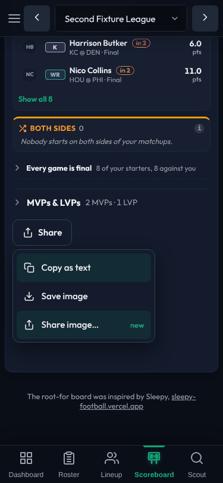
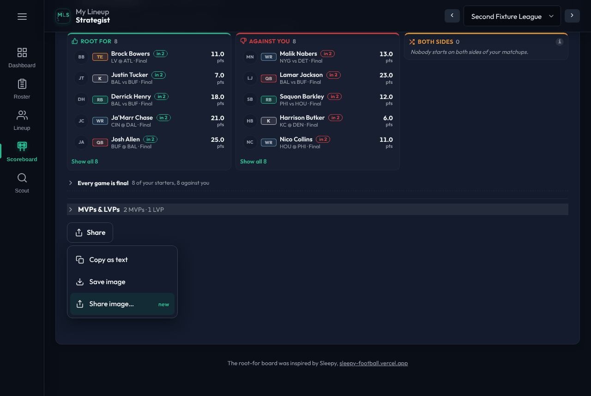

One snag for the build: html2canvas loads on first use (`loadHtml2Canvas`, ~200 KB) and drawing takes a moment, and the
share sheet must open within a short time of the tap (transient activation), or the browser refuses with
`NotAllowedError`. So: draw the image when the menu opens (or keep the last one drawn) and share on the item's tap; if
the browser still refuses, save it instead and say so.

### Link previews in group chats

| Page | `og:title` | `og:image` | Problems |
|---|---|---|---|
| `/` | "My Draft Strategist - Lineup & Draft Tools" | `images/5775.svg` | SVG: iMessage, Facebook, Discord, Slack and X don't preview SVG, so a shared link shows no picture. No `og:type`, `og:site_name`, `og:image:width/height/alt` or `twitter:image`. |
| `/lineup/` | **" My Lineup Strategist \| My Draft Strategist"** (leading space) | `images/mls-app-icon.png`, **512×512** | `twitter:card` is `summary_large_image`, so a square icon gets cropped to 1.91:1. **`og:url` is `https://mydraftstrategist.com`** (the root), so Facebook and some chat apps treat a shared `/lineup/` link as the Draft page. No `<meta name="description">`. |
| `/t-score/` | "The T-Score Model \| My Draft Strategist" | `images/5775.svg` | SVG, as `/`. |

Proposal: one **1200×630 PNG per page** (about 30 to 60 KB each), drawn once and committed under `images/` (not in
`PRECACHE_ASSETS`: only link crawlers fetch them), plus the tag fixes: `/lineup/`'s title and `og:url`, a description,
`og:type=website`, `og:site_name`, `og:image:width`/`height`/`alt`, `twitter:image`. Drafts of the three images:

**A. White and green** (first draft, an arbitrary choice; it doesn't match anything on the site):

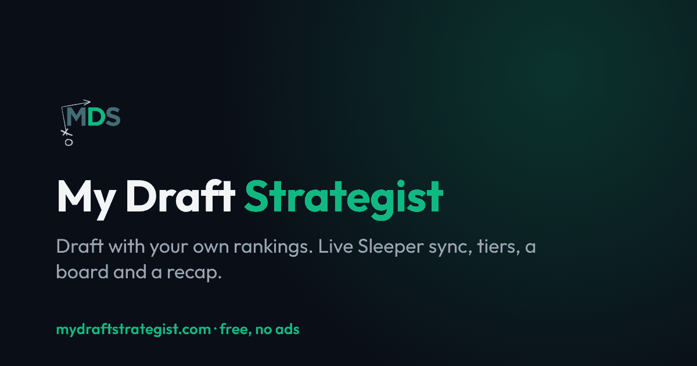
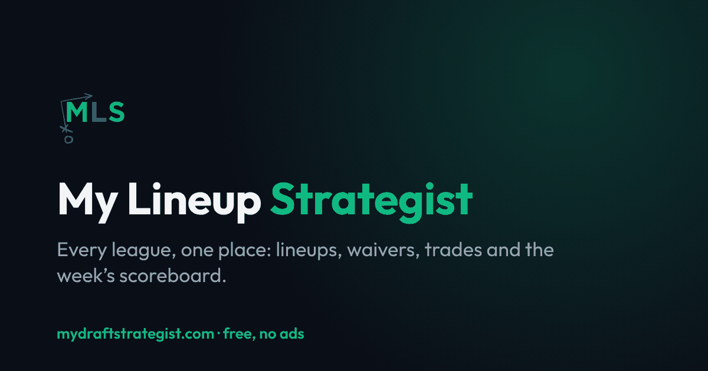
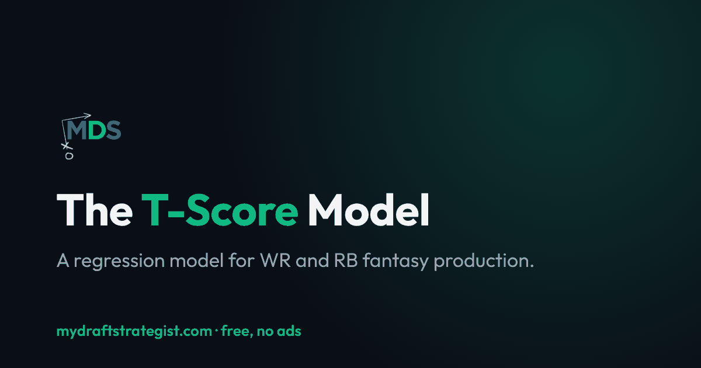

**B. As the header text** (muted "My Draft", bold white "Strategist", on one line):

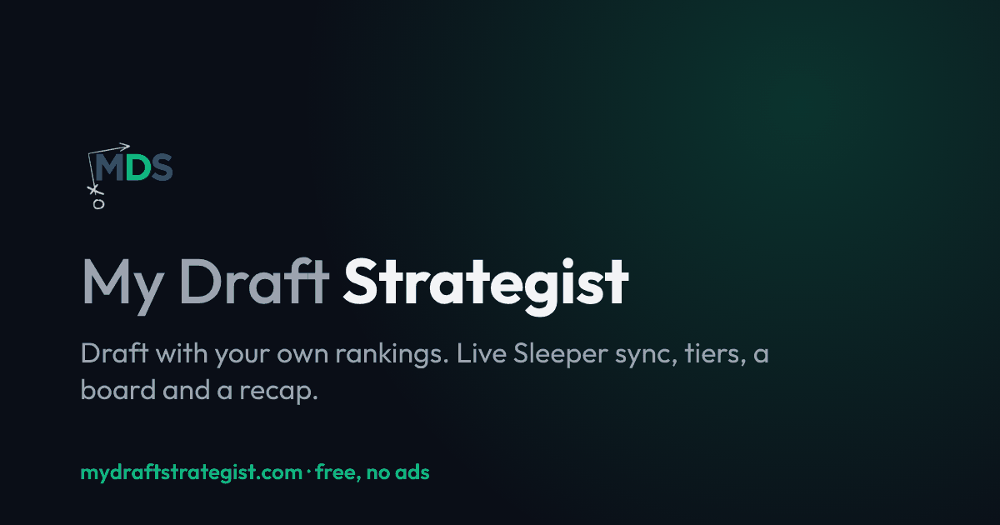
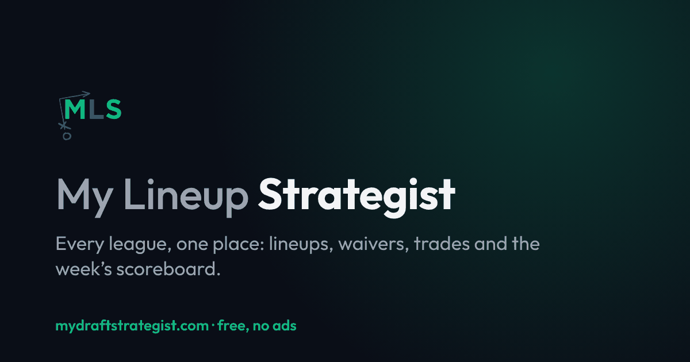
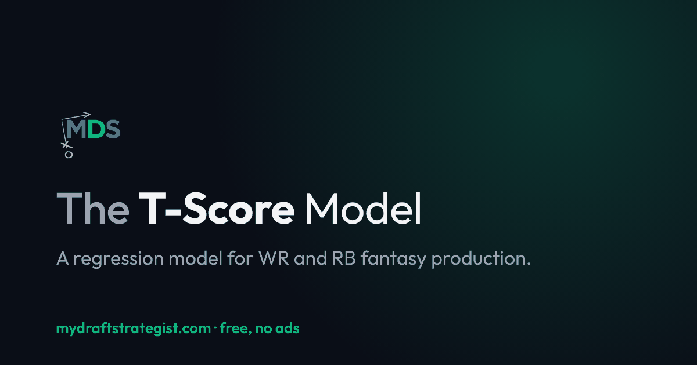

**C. The hero logo itself** (added 2026-11-07: the owner meant the colored hero image, `images/logo.svg` and
`images/mls-logo.svg`, with its blue and green words and the play-diagram arrows). The logo is drawn as it is, with a
one-line description under it; T-Score uses Draft Strategist's logo with its own title:

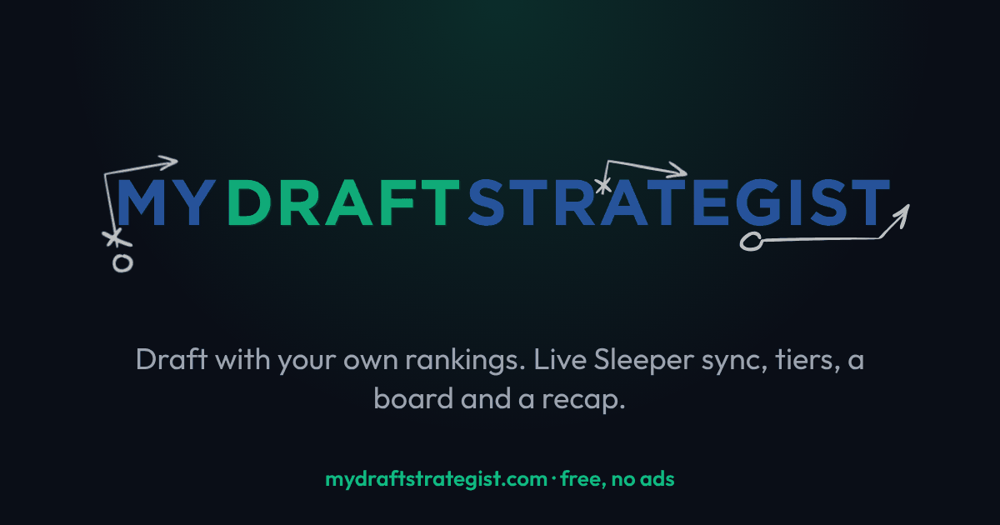
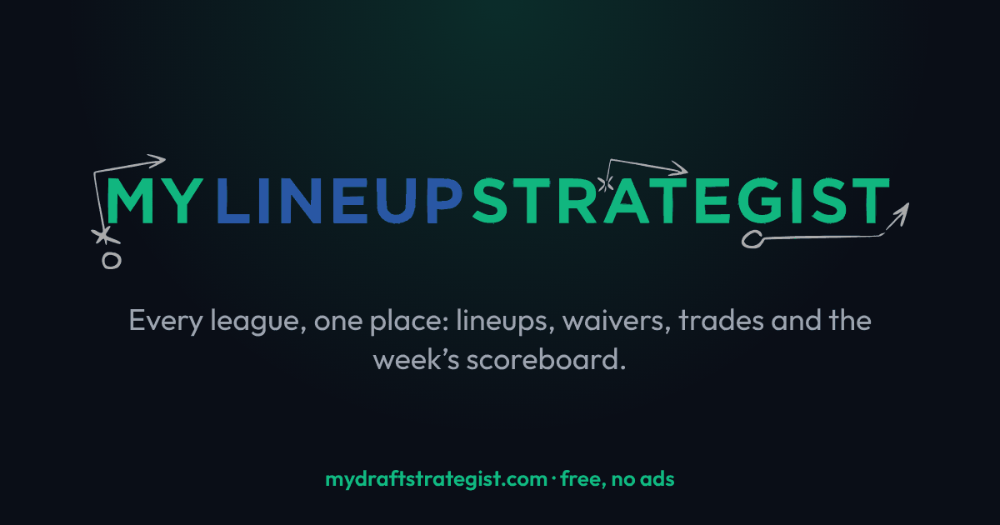
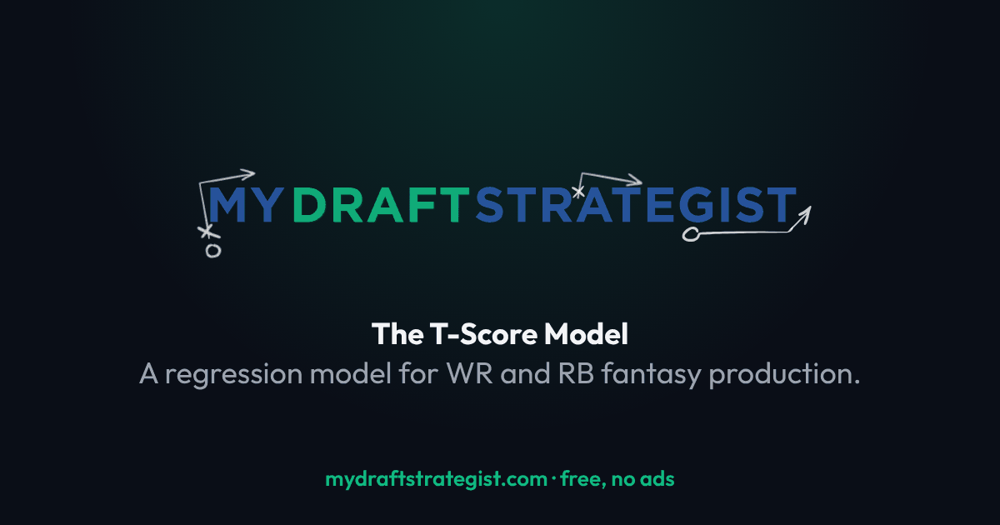

Chat apps cache previews for days, so the PNG names should carry a version (`og-lineup-1.png`) to force a refresh later.

### Counting shared links (`?ref=share`)

A1's loader sets `data-exclude-search`, so Umami never sees query strings: a bare `?ref=share` wouldn't show anywhere.
The loader can read `ref=share` itself (as it reads `?nocount=1`), take it out of the address bar, and send one
custom event, `Shared link opened` with the page. Umami's referrer can't do this: chat apps send none, so these visits
show as "direct". A small addition to `js/shared/analytics.js` and its tests, in K3.

---

## 6. All at once, or in stages

Stages, **one change at a time**, at least two weeks of numbers between them (Umami: Ko-fi taps by `where`, Share taps,
Shared link opened; Ko-fi's own dashboard: supporters and amounts). Each stage is a runbook card:

| Stage | Card | When | Size | What it changes | What it teaches before the next |
|---|---|---|---|---|---|
| 1 | **K2: Ko-fi easier to find, and Share** | Any time (now) | ~12k tok | Our Ko-fi button in place of the PNG (three drawers, two Dashboard feet; fixes the "Buy Me a Coffee" alt and the missing `rel`); the header cup; "About this project" in both Guides and a line in T-Score; "Share this site" in the drawers and Guides (`js/shared/ui/share.js`); Umami events on Ko-fi and Share; the Guide's Visitor Counts line updated. Re-takes the Guide and Dashboard screenshots. | Whether visibility alone brings tips (Ko-fi taps by place). If it does, the ask may need to be even rarer. |
| 1 | **K3: Link previews and `?ref=share`** | Any time, alongside K2 (different files) | ~6k tok | Three 1200×630 PNGs; the three pages' head tags; `?ref=share` counted by the loader. No screenshots change. | How many visits come from shared links. |
| 2 | **K4: The polite rules, and Lineup Strategist's ask** | By week 12, so a few Final weeks remain | ~15k tok | `askRules.js` + unit tests; the two keys; the quiet window; the Final-week card under the Week Recap and the season's thank-you; the ask's Share button. | Whether a calm, rare ask converts better than the always-there button, and whether anyone presses "Maybe later" over and over (then it's too often). |
| 3 | **K6: Draft Strategist's post-draft ask** | Before August | ~10k tok | Draft-complete detection (Sleeper's `status`, picks = teams × rounds, the manual fallback); the card under the Draft Recap; reuses K4's rules. | The draft-season response, next to the Lineup numbers. |
| (after M9) | **K5: "Share image…" in the Share split button** | After M9 merges (spring or summer), before August | ~6k tok | The third item in M9's split button on the lineup, the Week Recap, Export Trade and Export Team. | How often images are shared rather than saved. |
| 4 | **K7: Supporter perks** | Only if you decide on a membership | ~8k tok, accents ~+8k after M6/M14 | The honor switch in Settings; the Guide's thank-you list; (later) accents. Ko-fi tiers, posts and polls: you, on Ko-fi. | |

K2 and K3 can run together; K4 needs K2 (the share helper and the button style). K6 needs K4. K5 needs M9 and K2.

---

## Terms of the services the apps use

Tips are a gift; a membership with perks is closer to selling. What each provider says, read 2026-11-06 (I'm not a
lawyer; the unclear parts are listed for you to ask about):

- **Sleeper's API** (leagues, rosters, drafts, players, projections; `api.sleeper.app`). [docs.sleeper.com](https://docs.sleeper.com/):
  *"The Sleeper API is a read-only HTTP API that is free to use for non-commercial purposes ... For commercial use of
  the Sleeper API, please reach out to us directly ... to discuss licensing."* Also: stay under 1,000 calls a minute.
  **Unclear:** whether a tip jar makes a free site "commercial". A membership with perks makes it more likely. **Ask
  Sleeper** (the address on that page) before stage 4, and ideally before stage 2's ask, in one short email: free site,
  no ads, nothing locked, an optional Ko-fi tip jar; is that non-commercial?
- **Sleeper's headshot CDN** (`sleepercdn.com`): no published terms that I could find; the same company, so include it
  in the same email.
- **FantasyCalc** (`api.fantasycalc.com/values/current`, market values in both apps).
  [Terms of Usage, effective 10 October 2026](https://fantasycalc.com/terms-of-usage) and
  [API docs](https://fantasycalc.com/api-docs): free for sites **under 1,000 monthly active users**, with attribution
  ("FantasyCalc" near the data on every page that shows it, and a link to fantasycalc.com in the initial HTML); only
  `GET /values/current`; responses **"must be cached and reused across users and requests"**, refreshed at most every
  three hours; no "material substitute" for their trade calculator; nothing on sites affiliated with gambling. Nothing
  about donations. FantasyCalc has a Donate link itself. **Findings beyond K1, for a separate card:**
  1. **The apps call FantasyCalc from each browser**, so nothing is shared across users. The FFC proxy
     (`functions/api/ffc/`) already caches server-side; FantasyCalc would need the same (a Pages Function with a
     three-hour shared cache).
  2. **1,000 monthly active users:** Umami shows this now. At or above it, FantasyCalc wants written permission
     (fantasycalcff@gmail.com).
  3. **What the apps take from FantasyCalc** (corrected after the owner's question): only each player's `overallRank`
     (`js/shared/api/market.js`); FantasyCalc's own `value` is never read. Lineup Strategist uses that rank list as a
     ROS rankings source, for Market Disconnect, and as the "market" side of the Trade Analyzer, which turns ranks into
     its own values. That helps: the apps don't copy FantasyCalc's values or its calculator. But the terms cover "our
     data or derivatives", and a rank list is their data, so only FantasyCalc can say whether a trade tool built partly
     on it is a "material substitute". Worth asking in the same email.
  4. Attribution: `/lineup/` has the link in its HTML (`#attributionLink`); check that every place showing their values
     names FantasyCalc nearby, Draft Strategist included.
- **Fantasy Football Calculator** (ADP, through `functions/api/ffc/`). Its
  [ADP REST API help page](https://help.fantasyfootballcalculator.com/article/42-adp-rest-api) (quoted in search
  results; the help site isn't reachable from this session) says the API is *"free for personal and commercial use"*,
  asks for attribution (a link or mention) and not to call it often (it updates daily; the proxy caches it). **Low
  risk.** Please open the page to confirm the wording.
- **ESPN's scoreboard** (`site.api.espn.com`, kickoff times and game states). It's an undocumented API; ESPN's terms
  are Disney's [Terms of Use](https://disneytermsofuse.com/english/) (updated 24 May 2024): a licence "for your
  personal, noncommercial use only"; you may not "use the Disney Products for any commercial or business-related use
  ... whether or not for profit", or "access, monitor, copy or extract the Disney Products using a robot, spider,
  script, or other automated means". **This is a risk today, tips or not**: the apps fetch the scoreboard with a
  script. Tips change little; a paid membership makes "commercial" harder to argue. Nobody enforces this against small
  fan sites as far as I know, but it's the provider where the words are clearest. If it matters to you, kickoff times
  could come from another source in a later card.

  **Am I certain tips break these terms? No.** Nobody can be from the text: "commercial or business-related use ...
  whether or not for profit" is broad, and a tip jar on a free site is a grey area. What is clear is that the script
  access is already outside the terms, with or without tips, so tips add little to a risk the site already has.

  **Alternatives to ESPN** (checked 2026-11-07). ESPN gives the apps three things: kickoff times (FLEX kickoff order,
  the Command Center's locks, the quiet window), each game's state (pre / in / post, for Final), and the game clock
  (the share of a game left, for the Simulator's live win chances).
  - **Sleeper's schedule** (`api.sleeper.com/schedule/nfl/regular/<season>`, undocumented, the same company and terms
    as the API the apps already use): each game's week, date, teams and status (`pre_game`, `complete`; presumably an
    in-game value on Sundays). **No kickoff time and no clock.** Enough for Final, not for kickoff order.
  - **nflverse's schedule** (`games.csv`, already used by `scripts/update-byes.mjs`): kickoff date and time for every
    game, as a file. It could be written into the repo each May like the byes, but flexed games (late-season Sunday
    night changes) would need a re-run, and it has no live state. The `nfldata` repository has no licence file
    (checked), so its terms are unclear too.
  - Together, Sleeper's status plus nflverse's times could replace ESPN for everything but the game clock; the
    Simulator would estimate the share of a game left from the kickoff time instead. About a ~15k card, and a
    weaker live win chance. **Recommendation:** not for tips alone; reconsider if you start a membership.
- **NFLMeta**: not used (docs/refactor/LOG.md); its free plan bars commercial use.

---

### Alternatives to FantasyCalc for "the market" (owner's question, 2026-11-07)

What FantasyCalc gives Lineup Strategist: a rank list built from real trades, for redraft and dynasty, 1QB and
superflex, by league size and scoring, refreshed through the season. Checked 2026-11-07:

| Source | What it is | Terms | Fits? |
|---|---|---|---|
| **Fantasy Football Calculator's ADP** (already used by Draft Strategist through `functions/api/ffc/`) | Average draft position from mock drafts | "Free for personal and commercial use", attribution asked (the cleanest terms of any source here) | **No in season.** ADP stops moving once drafts end: its dynasty ADP for 2026 today covers 62 drafts from 5 Sep to 5 Oct and lists **no players**. A preseason market only. |
| **Sleeper's `search_rank`** (a field in the player file the apps already download; `js/mls/players.js` reads it to break name ties) | Sleeper's own ordering of players | Sleeper's API terms, which the apps already depend on (non-commercial) | **Weak.** Undocumented, one list (no dynasty / superflex / scoring split), and nobody knows what it measures. No new provider, though. |
| **Sleeper's trending adds and drops** (documented; S6 shows it already) | Who's being picked up this week | Sleeper's | A signal, not a ranking. Already in the app. |
| **DynastyProcess** (`github.com/dynastyprocess/data`, `values.csv`, GPL-3) | Dynasty values, updated weekly | GPL-3 on the repository, but the numbers are **FantasyPros' expert consensus** (each row has an `fp_id`, scraped weekly), and FantasyPros' own terms are personal, non-commercial use | **No**: dynasty only, experts rather than a market, and the underlying terms are worse, not better. |
| **FantasyPros** (expert consensus) | Experts, not trades | API by request; personal, non-commercial; no competing products | No. |
| **KeepTradeCut** | A crowd market (dynasty) | No public API; reading its pages would be scraping | No. |

**Finding: there's no drop-in alternative.** FantasyCalc is the only source here that's a market made from real trades,
for redraft and dynasty, with a documented API that small sites are invited to use. Its terms are demanding but clear,
and all of them can be met:
1. **Cache it once for everyone**: a Pages Function in front of `values/current`, with a three-hour shared cache, as
   `functions/api/ffc/` does for FFC (about a ~10k card). The browser then never calls FantasyCalc directly.
2. **Attribution**: already in `/lineup/`'s HTML; the card checks it's near the data on every view that shows it
   (Market Disconnect, the Trade Analyzer's market side, the ROS source).
3. **Under 1,000 monthly active users**: Umami shows this; write to them before reaching it.
4. **The Trade Analyzer**: ask them in the same email whether ranks feeding your own values, beside your own
   rankings, are fine.

The other way out is to stop shipping a market and let people upload one, as they can already ("Upload Market
rankings from KTC or FantasyCalc", `#marketFileInput`): the app then reads a file the person chose, and no terms of
use apply to the site. That loses the one-tap convenience, so I'd only fall back to it if FantasyCalc says no.

## Decisions for you

1. **Finding Ko-fi:** all four placements (our button in place of the PNG, the header cup, "About this project" in the
   Guides, the Dashboard foot line), or which ones? The header cup on phones too, or computers only? And no floating
   widget (agree?).
2. **Moments:** Lineup Strategist's Final-week ask first, plus the season thank-you; Draft Strategist's when the whole
   draft is complete, under the Draft Recap. Waiver and Trade runs counted but never asked on. OK?
3. **Polite rules:** N = 1 completed draft; N = 2 Final weeks this season (3 from next); one ask per app per season,
   plus the thank-you; "Maybe later" 30 days (Lineup) or until next season (Draft); one key per app; a new device may
   ask once more. Any number you'd change?
4. **Perks and membership:** tips only for now, decide on a membership next summer? If yes later: one $5 tier (or
   yearly if Ko-fi has it), honor switch, no webhook. Please also check on Ko-fi: your fee setting on tips, whether
   yearly billing and welcome messages exist.
5. **Sharing:** the Share button in the drawer, the Guide note, the ask and the Dashboard foot; "Share image…" as the
   third item of M9's split button; the three preview PNGs (do the drafts above work, or another look?); `?ref=share`
   counted. OK?
6. **Stages:** K2 + K3 now, K4 by week 12, K6 before August, K5 after M9, K7 only with a membership. OK?
7. **Terms:** will you email Sleeper (non-commercial question) and FantasyCalc (users, caching, Trade Analyzer)? And
   should a separate card route FantasyCalc through a cached Pages Function, as FFC is?
